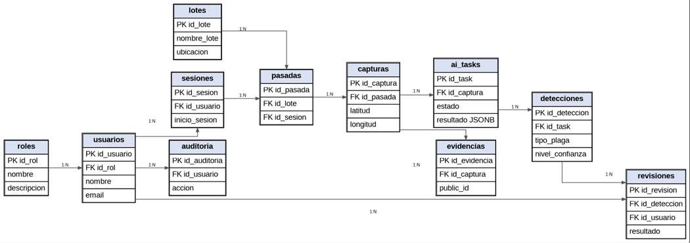

# Modelo lógico de datos (10.2)

| Campo | Valor |
|---|---|
| Archivo de imagen | `01-documentacion-principal/media/image42.png` |
| Tipo | Diagrama de tablas con claves |
| Aparece en | [`capitulo-10-base-de-datos.md`](../../01-documentacion-principal/capitulo-10-base-de-datos.md) — 10.2. Modelo lógico |
| Fuente | Informe principal (versión revisada, noviembre 2026) |

## Qué muestra

Pasa el modelo conceptual a tablas con claves primarias (PK) y foráneas (FK).

## Transcripción

| Tabla | Columnas |
|---|---|
| roles | PK id_rol · nombre · descripcion |
| usuarios | PK id_usuario · FK id_rol · nombre · email |
| auditoria | PK id_auditoria · FK id_usuario · accion |
| lotes | PK id_lote · nombre_lote · ubicacion |
| sesiones | PK id_sesion · FK id_usuario · inicio_sesion |
| pasadas | PK id_pasada · FK id_lote · FK id_sesion |
| capturas | PK id_captura · FK id_pasada · latitud · longitud |
| evidencias | PK id_evidencia · FK id_captura · public_id |
| ai_tasks | PK id_task · FK id_captura · estado · resultado JSONB |
| detecciones | PK id_deteccion · FK id_task · tipo_plaga · nivel_confianza |
| revisiones | PK id_revision · FK id_deteccion · FK id_usuario · resultado |

Relaciones 1:N: roles→usuarios · usuarios→sesiones · usuarios→auditoria · usuarios→revisiones · lotes→pasadas · sesiones→pasadas · pasadas→capturas · capturas→evidencias · capturas→ai_tasks · ai_tasks→detecciones · detecciones→revisiones.

## Vigencia frente al sistema actual

> Modelo de datos **del diseño inicial** (ver la «Nota de alcance» del capítulo 10). La base real la crean las migraciones de Django y tiene otras tablas y nombres (users, devices, field_lots, field_rows, field_segments, markers, monitoring_sessions, monitoring_passes, capture_sequences, captures, quality_results, model_configs, ai_tasks, detections, review_cases, human_reviews, notifications, audit_events…). Ver `05-repositorios-de-codigo/plataforma-web/docs/ARQUITECTURA_DATOS.md` y `00-contexto/03-arquitectura-y-tecnologias.md`.
