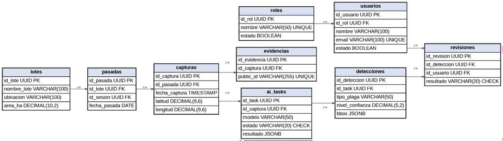

# Modelo físico de datos (10.3)

| Campo | Valor |
|---|---|
| Archivo de imagen | `01-documentacion-principal/media/image43.png` |
| Tipo | Diagrama de tablas con tipos de datos |
| Aparece en | [`capitulo-10-base-de-datos.md`](../../01-documentacion-principal/capitulo-10-base-de-datos.md) — 10.3. Modelo físico |
| Fuente | Informe principal (versión revisada, noviembre 2026) |

## Qué muestra

Define los tipos de datos para PostgreSQL: identificadores UUID, coordenadas con 6 decimales, resultados de la IA en JSONB y restricciones CHECK de estado.

## Transcripción

| Tabla | Columnas y tipos |
|---|---|
| roles | id_rol UUID PK · nombre VARCHAR(50) UNIQUE · estado BOOLEAN |
| usuarios | id_usuario UUID PK · id_rol UUID FK · nombre VARCHAR(100) · email VARCHAR(100) UNIQUE · estado BOOLEAN |
| lotes | id_lote UUID PK · nombre_lote VARCHAR(100) · ubicacion VARCHAR(100) · area_ha DECIMAL(10,2) |
| pasadas | id_pasada UUID PK · id_lote UUID FK · id_sesion UUID FK · fecha_pasada DATE |
| capturas | id_captura UUID PK · id_pasada UUID FK · fecha_captura TIMESTAMP · latitud DECIMAL(9,6) · longitud DECIMAL(9,6) |
| evidencias | id_evidencia UUID PK · id_captura UUID FK · public_id VARCHAR(255) UNIQUE |
| ai_tasks | id_task UUID PK · id_captura UUID FK · modelo VARCHAR(50) · estado VARCHAR(20) CHECK · resultado JSONB |
| detecciones | id_deteccion UUID PK · id_task UUID FK · tipo_plaga VARCHAR(50) · nivel_confianza DECIMAL(5,2) · bbox JSONB |
| revisiones | id_revision UUID PK · id_deteccion UUID FK · id_usuario UUID FK · resultado VARCHAR(20) CHECK |

Relaciones 1:N: roles→usuarios · usuarios→revisiones · lotes→pasadas · pasadas→capturas · capturas→evidencias · capturas→ai_tasks · ai_tasks→detecciones · detecciones→revisiones.

## Vigencia frente al sistema actual

> Modelo de datos **del diseño inicial** (ver la «Nota de alcance» del capítulo 10). La base real la crean las migraciones de Django y tiene otras tablas y nombres (users, devices, field_lots, field_rows, field_segments, markers, monitoring_sessions, monitoring_passes, capture_sequences, captures, quality_results, model_configs, ai_tasks, detections, review_cases, human_reviews, notifications, audit_events…). Ver `05-repositorios-de-codigo/plataforma-web/docs/ARQUITECTURA_DATOS.md` y `00-contexto/03-arquitectura-y-tecnologias.md`.
