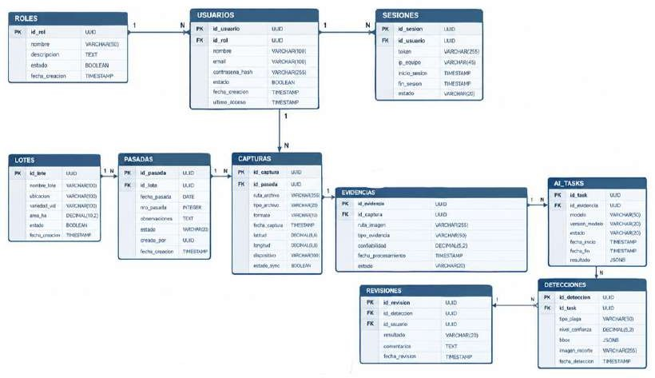

# Diagrama entidad-relación (10.4)

| Campo | Valor |
|---|---|
| Archivo de imagen | `01-documentacion-principal/media/image44.jpeg` |
| Tipo | Diagrama entidad-relación detallado |
| Aparece en | [`capitulo-10-base-de-datos.md`](../../01-documentacion-principal/capitulo-10-base-de-datos.md) — 10.4. Diagrama entidad-relación |
| Fuente | Informe principal (versión revisada, noviembre 2026) |

## Qué muestra

Versión más completa del diseño de datos, con fechas de auditoría, versión del modelo de IA, cajas (bbox) y recortes de cada detección. Lectura de la imagen ampliada; algunos tipos pueden variar levemente.

## Transcripción

| Tabla | Columnas (tipo) |
|---|---|
| ROLES | PK id_rol (UUID) · nombre (VARCHAR(50)) · descripcion (TEXT) · estado (BOOLEAN) · fecha_creacion (TIMESTAMP) |
| USUARIOS | PK id_usuario (UUID) · FK id_rol (UUID) · nombre (VARCHAR(100)) · email (VARCHAR(100)) · contrasena_hash (VARCHAR(255)) · estado (BOOLEAN) · fecha_creacion (TIMESTAMP) · ultimo_acceso (TIMESTAMP) |
| SESIONES | PK id_sesion (UUID) · FK id_usuario (UUID) · token (VARCHAR(255)) · ip_equipo (VARCHAR(45)) · inicio_sesion (TIMESTAMP) · fin_sesion (TIMESTAMP) · estado (VARCHAR(20)) |
| LOTES | PK id_lote (UUID) · nombre_lote (VARCHAR(100)) · ubicacion (VARCHAR(100)) · variedad_vid (VARCHAR(100)) · area_ha (DECIMAL(10,2)) · estado (BOOLEAN) · fecha_creacion (TIMESTAMP) |
| PASADAS | PK id_pasada (UUID) · FK id_lote (UUID) · fecha_pasada (DATE) · nro_pasada (INTEGER) · observaciones (TEXT) · estado (VARCHAR(20)) · creado_por (UUID) · fecha_creacion (TIMESTAMP) |
| CAPTURAS | PK id_captura (UUID) · FK id_pasada (UUID) · ruta_archivo (VARCHAR(255)) · tipo_archivo (VARCHAR(20)) · formato (VARCHAR(10)) · fecha_captura (TIMESTAMP) · latitud (DECIMAL(9,6)) · longitud (DECIMAL(9,6)) · dispositivo (VARCHAR(100)) · estado_sync (BOOLEAN) |
| EVIDENCIAS | PK id_evidencia (UUID) · FK id_captura (UUID) · ruta_imagen (VARCHAR(255)) · tipo_evidencia (VARCHAR(50)) · confiabilidad (DECIMAL(5,2)) · fecha_procesamiento (TIMESTAMP) · estado (VARCHAR(20)) |
| AI_TASKS | PK id_task (UUID) · FK id_evidencia (UUID) · modelo (VARCHAR(50)) · version_modelo (VARCHAR(20)) · estado (VARCHAR(20)) · fecha_inicio (TIMESTAMP) · fecha_fin (TIMESTAMP) · resultado (JSONB) |
| DETECCIONES | PK id_deteccion (UUID) · FK id_task (UUID) · tipo_plaga (VARCHAR(50)) · nivel_confianza (DECIMAL(5,2)) · bbox (JSONB) · imagen_recorte (VARCHAR(255)) · fecha_deteccion (TIMESTAMP) |
| REVISIONES | PK id_revision (UUID) · FK id_deteccion (UUID) · FK id_usuario (UUID) · resultado (VARCHAR(20)) · comentario (TEXT) · fecha_revision (TIMESTAMP) |

Cardinalidades: ROLES 1–N USUARIOS · USUARIOS 1–N SESIONES · USUARIOS 1–N CAPTURAS · LOTES 1–N PASADAS · PASADAS 1–N CAPTURAS · CAPTURAS 1–N EVIDENCIAS · EVIDENCIAS 1–N AI_TASKS · AI_TASKS 1–N DETECCIONES · DETECCIONES 1–N REVISIONES.

## Vigencia frente al sistema actual

> Modelo de datos **del diseño inicial** (ver la «Nota de alcance» del capítulo 10). La base real la crean las migraciones de Django y tiene otras tablas y nombres (users, devices, field_lots, field_rows, field_segments, markers, monitoring_sessions, monitoring_passes, capture_sequences, captures, quality_results, model_configs, ai_tasks, detections, review_cases, human_reviews, notifications, audit_events…). Ver `05-repositorios-de-codigo/plataforma-web/docs/ARQUITECTURA_DATOS.md` y `00-contexto/03-arquitectura-y-tecnologias.md`.
