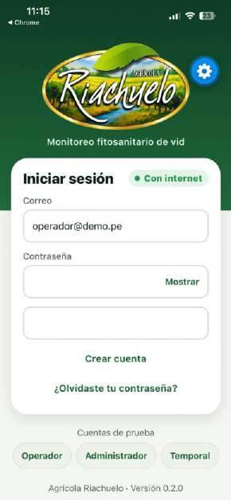

# Evidencia de despliegue (13.7): app — pantalla «Iniciar sesión»

| Campo | Valor |
|---|---|
| Archivo de imagen | `01-documentacion-principal/media/image45.jpeg` |
| Tipo | Captura de pantalla de la app móvil |
| Aparece en | [`capitulo-13-despliegue.md`](../../01-documentacion-principal/capitulo-13-despliegue.md) — 13.7. Evidencias |
| Fuente | Informe principal (versión revisada, noviembre 2026) |

## Qué muestra

Pantalla de ingreso (PANT-02) con cuentas de demostración del entorno de desarrollo.

## Transcripción

- Logo «Agrícola Riachuelo» y lema «Monitoreo fitosanitario de vid». Botón de ajustes (engranaje azul).
- Tarjeta «Iniciar sesión» con indicador «● Con internet»: campo «Correo» = «operador@demo.pe» · campo «Contraseña» con botón «Mostrar» · campo adicional vacío.
- Enlaces «Crear cuenta» y «¿Olvidaste tu contraseña?».
- «Cuentas de prueba»: botones «Operador» · «Administrador» · «Temporal».
- Pie: «Agrícola Riachuelo · Versión 0.2.0».

## Vigencia frente al sistema actual

> Captura real de la app en una versión temprana (**0.2.0**, octubre 2026), ejecutada en un iPhone durante el desarrollo con Expo. Desde entonces cambió: el piloto usa 3 celulares **Android**; las dos cámaras miran el **mismo** lado de la hilera (SC-04); la app actual es la **0.6.1**. Pantallas actuales en `03-manuales/manual-de-usuario-app-movil.md`.
