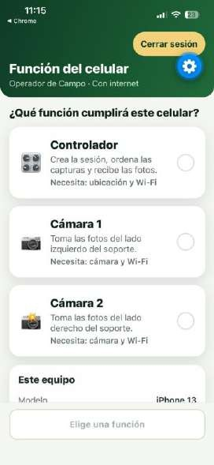

# Evidencia de despliegue (13.7): app — pantalla «Función del celular»

| Campo | Valor |
|---|---|
| Archivo de imagen | `01-documentacion-principal/media/image46.jpeg` |
| Tipo | Captura de pantalla de la app móvil |
| Aparece en | [`capitulo-13-despliegue.md`](../../01-documentacion-principal/capitulo-13-despliegue.md) — 13.7. Evidencias |
| Fuente | Informe principal (versión revisada, noviembre 2026) |

## Qué muestra

Elección de la función del celular después de cada ingreso (PANT-08).

## Transcripción

- Encabezado verde «Función del celular» · «Operador de Campo · Con internet» · botón «Cerrar sesión».
- «¿Qué función cumplirá este celular?»:
  - **Controlador** — «Crea la sesión, ordena las capturas y recibe las fotos. Necesita: ubicación y Wi-Fi».
  - **Cámara 1** — «Toma las fotos del lado izquierdo del soporte. Necesita: cámara y Wi-Fi».
  - **Cámara 2** — «Toma las fotos del lado derecho del soporte. Necesita: cámara y Wi-Fi».
- «Este equipo»: Modelo «iPhone 13». Botón «Elige una función».

## Vigencia frente al sistema actual

> Captura real de la app en una versión temprana (**0.2.0**, octubre 2026), ejecutada en un iPhone durante el desarrollo con Expo. Desde entonces cambió: el piloto usa 3 celulares **Android**; las dos cámaras miran el **mismo** lado de la hilera (SC-04); la app actual es la **0.6.1**. Pantallas actuales en `03-manuales/manual-de-usuario-app-movil.md`. El texto «lado izquierdo/derecho del soporte» ya no aplica.
