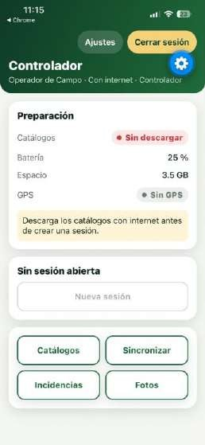

# Evidencia de despliegue (13.7): app — panel del «Controlador»

| Campo | Valor |
|---|---|
| Archivo de imagen | `01-documentacion-principal/media/image47.jpeg` |
| Tipo | Captura de pantalla de la app móvil |
| Aparece en | [`capitulo-13-despliegue.md`](../../01-documentacion-principal/capitulo-13-despliegue.md) — 13.7. Evidencias |
| Fuente | Informe principal (versión revisada, noviembre 2026) |

## Qué muestra

Panel del controlador (PANT-10): revisa si el celular está listo (catálogos, batería, espacio, GPS) antes de crear una sesión.

## Transcripción

- Encabezado «Controlador» · «Operador de Campo · Con internet · Controlador» · botones «Ajustes» y «Cerrar sesión».
- «Preparación»: Catálogos «● Sin descargar» · Batería 25 % · Espacio 3.5 GB · GPS «● Sin GPS». Aviso: «Descarga los catálogos con internet antes de crear una sesión.»
- «Sin sesión abierta»: botón «Nueva sesión» (deshabilitado).
- Botones: «Catálogos» · «Sincronizar» · «Incidencias» · «Fotos».

## Vigencia frente al sistema actual

> Captura real de la app en una versión temprana (**0.2.0**, octubre 2026), ejecutada en un iPhone durante el desarrollo con Expo. Desde entonces cambió: el piloto usa 3 celulares **Android**; las dos cámaras miran el **mismo** lado de la hilera (SC-04); la app actual es la **0.6.1**. Pantallas actuales en `03-manuales/manual-de-usuario-app-movil.md`.
