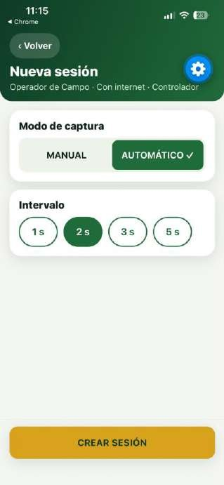

# Evidencia de despliegue (13.7): app — «Nueva sesión» en modo automático

| Campo | Valor |
|---|---|
| Archivo de imagen | `01-documentacion-principal/media/image49.jpeg` |
| Tipo | Captura de pantalla de la app móvil |
| Aparece en | [`capitulo-13-despliegue.md`](../../01-documentacion-principal/capitulo-13-despliegue.md) — 13.7. Evidencias |
| Fuente | Informe principal (versión revisada, noviembre 2026) |

## Qué muestra

Creación de una sesión (PANT-12) en modo automático: el controlador ordena una captura cada 2 segundos (solo con el celular quieto).

## Transcripción

- Botón «‹ Volver». Encabezado «Nueva sesión» · «Operador de Campo · Con internet · Controlador».
- «Modo de captura»: MANUAL · **AUTOMÁTICO ✓** (seleccionado).
- «Intervalo»: 1 s · **2 s** (seleccionado) · 3 s · 5 s.
- Botón amarillo «CREAR SESIÓN».

## Vigencia frente al sistema actual

> Captura real de la app en una versión temprana (**0.2.0**, octubre 2026), ejecutada en un iPhone durante el desarrollo con Expo. Desde entonces cambió: el piloto usa 3 celulares **Android**; las dos cámaras miran el **mismo** lado de la hilera (SC-04); la app actual es la **0.6.1**. Pantallas actuales en `03-manuales/manual-de-usuario-app-movil.md`.
