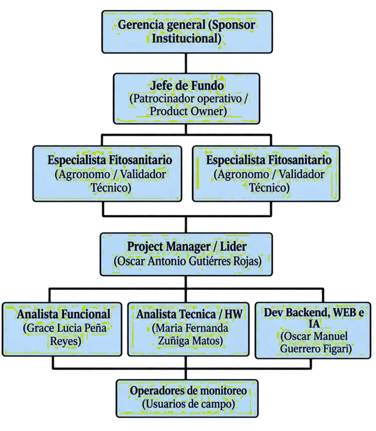

# Organigrama del proyecto (Anexo 23, AP-24)



| Campo | Valor |
|---|---|
| Archivo de imagen | `01-documentacion-principal/media/image52.png` |
| Tipo | Organigrama |
| Aparece en | [`anexos/anexo-23-ap-24-organigrama-del-proyecto.md`](../../01-documentacion-principal/anexos/anexo-23-ap-24-organigrama-del-proyecto.md) — ORGANIGRAMA DEL PROYECTO |
| Fuente | Informe principal (versión revisada, noviembre 2026) |

## Qué muestra

Estructura del equipo del proyecto: patrocinio de la empresa, validación técnica del especialista, el Project Manager y los tres integrantes del equipo, y los operadores como usuarios finales.

## Transcripción

```text
Gerencia general (Sponsor Institucional)
└── Jefe de Fundo (Patrocinador operativo / Product Owner)
    ├── Especialista Fitosanitario (Agrónomo / Validador Técnico)
    └── Especialista Fitosanitario (Agrónomo / Validador Técnico)
        └── Project Manager / Líder (Oscar Antonio Gutiérrez Rojas)
            ├── Analista Funcional (Grace Lucia Peña Reyes)
            ├── Analista Técnica / HW (María Fernanda Zúñiga Matos)
            └── Dev Backend, WEB e IA (Oscar Manuel Guerrero Figari)
                └── Operadores de monitoreo (Usuarios de campo)
```

## Vigencia frente al sistema actual

> En el resto del informe el **Product Owner** es el especialista fitosanitario (STK-03) y el jefe de fundo es el patrocinador operativo; este organigrama pone «Product Owner» junto al jefe de fundo. Si hay que citar el rol, usar el registro de interesados (capítulo 5) y el Anexo 25.
