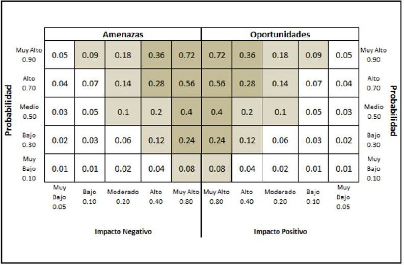

# Matriz de probabilidad e impacto (Anexo 28, AP-29)

| Campo | Valor |
|---|---|
| Archivo de imagen | `01-documentacion-principal/media/image53.jpeg` |
| Tipo | Matriz de riesgos (amenazas y oportunidades) |
| Aparece en | [`anexos/anexo-28-ap-29-plan-de-gestion-de-riesgos.md`](../../01-documentacion-principal/anexos/anexo-28-ap-29-plan-de-gestion-de-riesgos.md) — PLAN DE GESTIÓN DE LOS RIESGOS |
| Fuente | Informe principal (versión revisada, noviembre 2026) |

## Qué muestra

Herramienta para priorizar riesgos: el puntaje de cada riesgo es probabilidad × impacto. Los umbrales de nivel (Muy Alto > 0.50; Alto 0.30–0.50; Moderado 0.10–0.30; Bajo 0.05–0.10; Muy Bajo < 0.05) están en el plan de riesgos.

## Transcripción

Valores = probabilidad × impacto. Escalas — Probabilidad: Muy Alto 0.90 · Alto 0.70 · Medio 0.50 · Bajo 0.30 · Muy Bajo 0.10. Impacto: Muy Bajo 0.05 · Bajo 0.10 · Moderado 0.20 · Alto 0.40 · Muy Alto 0.80.

**Amenazas (impacto negativo)**

| Probabilidad \ Impacto | Muy Bajo 0.05 | Bajo 0.10 | Moderado 0.20 | Alto 0.40 | Muy Alto 0.80 |
|---|---:|---:|---:|---:|---:|
| Muy Alto 0.90 | 0.05 | 0.09 | 0.18 | 0.36 | 0.72 |
| Alto 0.70 | 0.04 | 0.07 | 0.14 | 0.28 | 0.56 |
| Medio 0.50 | 0.03 | 0.05 | 0.1 | 0.2 | 0.4 |
| Bajo 0.30 | 0.02 | 0.03 | 0.06 | 0.12 | 0.24 |
| Muy Bajo 0.10 | 0.01 | 0.01 | 0.02 | 0.04 | 0.08 |

**Oportunidades (impacto positivo)**: espejo de la tabla anterior (Muy Alto 0.80 → 0.72, 0.56, 0.4, 0.24, 0.08; Alto 0.40 → 0.36, 0.28, 0.2, 0.12, 0.04; Moderado 0.20 → 0.18, 0.14, 0.1, 0.06, 0.02; Bajo 0.10 → 0.09, 0.07, 0.05, 0.03, 0.01; Muy Bajo 0.05 → 0.05, 0.04, 0.03, 0.02, 0.01).

Sombreado: las celdas más oscuras (≈0.20 o más) son las de mayor prioridad.
