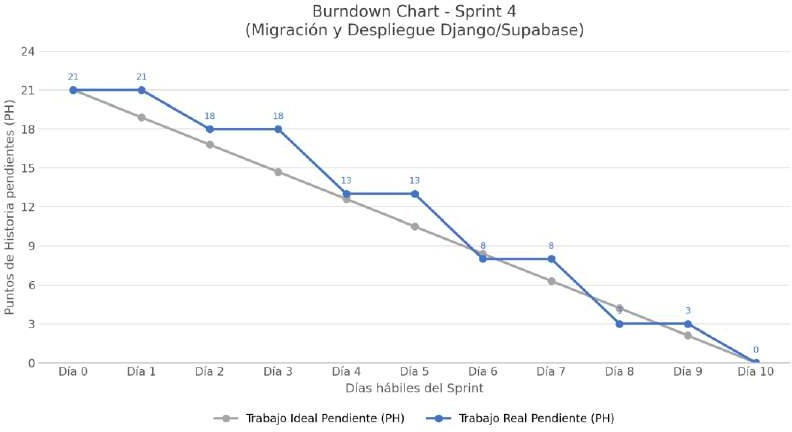

# Burndown Chart – Sprint 4 (Migración y Despliegue Django/Supabase) (Anexo 60, AS-12)

| Campo | Valor |
|---|---|
| Archivo de imagen | `01-documentacion-principal/media/image79.jpeg` |
| Tipo | Gráfico de líneas |
| Aparece en | [`anexos/anexo-60-as-12-burndown.md`](../../01-documentacion-principal/anexos/anexo-60-as-12-burndown.md) — Anexo 60 (AS-12): Burndown |
| Fuente | Informe principal (versión revisada, noviembre 2026) |

## Qué muestra

Avance del Sprint 4: el equipo cerró los 21 puntos en 10 días. El trabajo real bajó en escalones (entregas cada dos días) y se mantuvo cerca de la línea ideal, por debajo de ella en los días 6 y 8.

## Transcripción

Eje Y: Puntos de Historia pendientes (PH), 0–24. Eje X: días hábiles del sprint (Día 0 a Día 10).

| Día | 0 | 1 | 2 | 3 | 4 | 5 | 6 | 7 | 8 | 9 | 10 |
|---|---|---|---|---|---|---|---|---|---|---|---|
| Trabajo ideal pendiente (PH) | 21 | ≈18.9 | ≈16.8 | ≈14.7 | ≈12.6 | ≈10.5 | ≈8.4 | ≈6.3 | ≈4.2 | ≈2.1 | 0 |
| Trabajo real pendiente (PH) | 21 | 21 | 18 | 18 | 13 | 13 | 8 | 8 | 3 | 3 | 0 |
