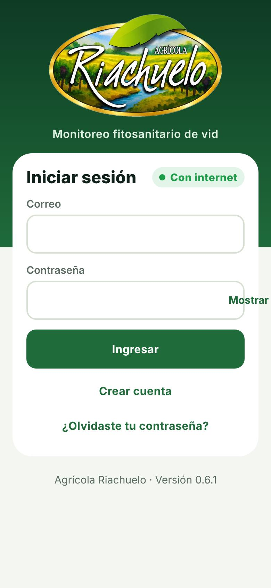

# Inicio de sesión de la app



| Dato | Valor |
|---|---|
| Archivo | `03-manuales/media/app/p06-08.jpeg` |
| Documento | Manual de usuario · App móvil (v0.6.1) |
| Sección | Instalar e ingresar (línea 367 del manual) |
| Tipo | Captura de pantalla de la app (celular) |

## Qué muestra

Pantalla de entrada de la app 0.6.1. Arriba el logo de Agrícola Riachuelo sobre fondo verde; abajo una tarjeta blanca con el formulario. La etiqueta verde «Con internet» indica que hay conexión, así que el ingreso se valida contra el servidor.

## Texto visible

Monitoreo fitosanitario de vid · Iniciar sesión · ● Con internet · Correo [campo] · Contraseña [campo] Mostrar · [Ingresar] · Crear cuenta · ¿Olvidaste tu contraseña? · Agrícola Riachuelo · Versión 0.6.1

<details><summary>Texto reconocido automáticamente (OCR, sin corregir)</summary>

```text
Monitoreo fitosanitario de vid
Iniciar sesión  ? Coninternet
Correo
Contraseña
Mostrar
Crear cuenta
¿Olvidaste tu contraseña?
Agrícola Riachuelo - Versión 0.6.1
```

</details>
