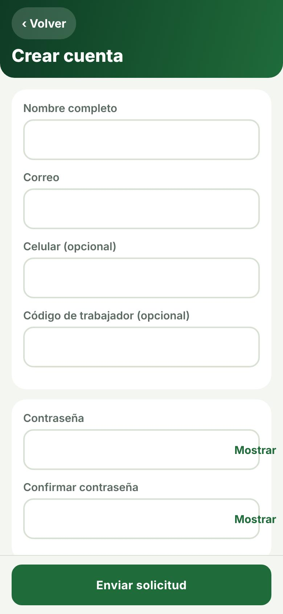

# Crear cuenta (registro del operador)



| Dato | Valor |
|---|---|
| Archivo | `03-manuales/media/app/p07-10.jpeg` |
| Documento | Manual de usuario · App móvil (v0.6.1) |
| Sección | Instalar e ingresar (línea 421 del manual) |
| Tipo | Captura de pantalla de la app (celular) |

## Qué muestra

Formulario de solicitud de cuenta que llena el propio operador de campo desde la app. La cuenta no queda activa al enviarla: un administrador la aprueba desde la web.

## Texto visible

‹ Volver · Crear cuenta · Nombre completo · Correo · Celular (opcional) · Código de trabajador (opcional) · Contraseña [Mostrar] · Confirmar contraseña [Mostrar] · [Enviar solicitud]

<details><summary>Texto reconocido automáticamente (OCR, sin corregir)</summary>

```text
< Volver
Crear cuenta
Nombre completo
Correo
Celular (opcional)
Código de trabajador (opcional)
Contraseña
Mostrar
Confirmar contraseña
Mostrar
Enviar solicitud
```

</details>
