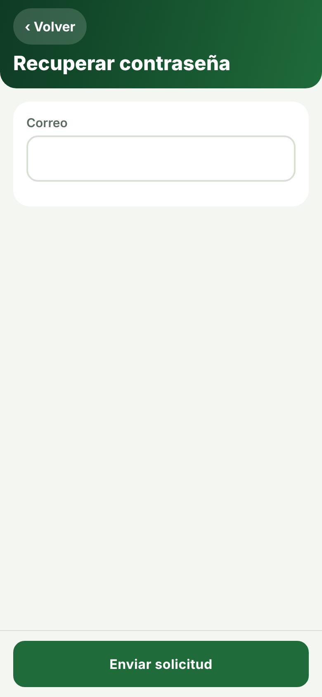

# Recuperar contraseña



| Dato | Valor |
|---|---|
| Archivo | `03-manuales/media/app/p07-12.jpeg` |
| Documento | Manual de usuario · App móvil (v0.6.1) |
| Sección | Instalar e ingresar (línea 425 del manual) |
| Tipo | Captura de pantalla de la app (celular) |

## Qué muestra

Pantalla para pedir una contraseña nueva: solo pide el correo y envía la solicitud al administrador.

## Texto visible

‹ Volver · Recuperar contraseña · Correo [campo] · [Enviar solicitud]

<details><summary>Texto reconocido automáticamente (OCR, sin corregir)</summary>

```text
< Volver
Recuperar contraseña
Correo
Enviar solicitud
```

</details>
