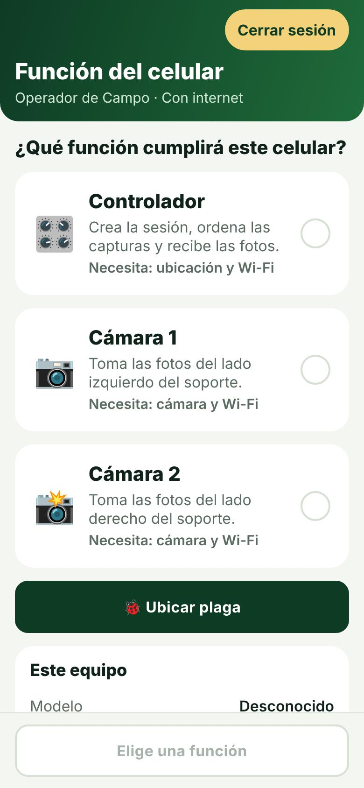

# Función del celular (sin elegir)



| Dato | Valor |
|---|---|
| Archivo | `03-manuales/media/app/p08-15.jpeg` |
| Documento | Manual de usuario · App móvil (v0.6.1) |
| Sección | Elegir la función del celular (línea 471 del manual) |
| Tipo | Captura de pantalla de la app (celular) |

## Qué muestra

Después de ingresar, la app pregunta qué papel cumplirá el equipo en la sesión: Controlador, Cámara 1 o Cámara 2. Cada opción dice qué necesita. Abajo está el acceso a «Ubicar plaga» y los datos del equipo. El botón inferior sigue desactivado («Elige una función»).

## Texto visible

Cerrar sesión · Función del celular · Operador de Campo · Con internet · ¿Qué función cumplirá este celular? · Controlador: Crea la sesión, ordena las capturas y recibe las fotos. Necesita: ubicación y Wi-Fi · Cámara 1: Toma las fotos del lado izquierdo del soporte. Necesita: cámara y Wi-Fi · Cámara 2: Toma las fotos del lado derecho del soporte. Necesita: cámara y Wi-Fi · [Ubicar plaga] · Este equipo · Modelo: Desconocido · [Elige una función]

<details><summary>Texto reconocido automáticamente (OCR, sin corregir)</summary>

```text
Función del celular
Operador de Campo - Con internet
¿Qué función cumplirá este celular?
Controlador
Crea la sesión, ordena las
capturas y recibe las fotos.
Necesita: ubicación y Wi-Fi
Cámara 1
pde Toma las fotos del lado
A ¡izquierdo del soporte.
Necesita: cámara y Wi-Fi
Cámara 2
ol Toma las fotos del lado
derecho del soporte.
Necesita: cámara y Wi-Fi
dx Ubicar plaga
Este equipo
Modelo Desconocido
```

</details>
