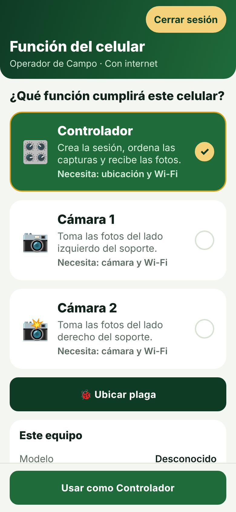

# Función del celular (Controlador elegido)



| Dato | Valor |
|---|---|
| Archivo | `03-manuales/media/app/p08-17.jpeg` |
| Documento | Manual de usuario · App móvil (v0.6.1) |
| Sección | Elegir la función del celular (línea 485 del manual) |
| Tipo | Captura de pantalla de la app (celular) |

## Qué muestra

La misma pantalla con «Controlador» marcado (tarjeta en verde con check). El botón inferior cambia a «Usar como Controlador».

## Texto visible

Cerrar sesión · Función del celular · ¿Qué función cumplirá este celular? · Controlador ✓ · Cámara 1 · Cámara 2 · [Ubicar plaga] · Este equipo · Modelo: Desconocido · [Usar como Controlador]

<details><summary>Texto reconocido automáticamente (OCR, sin corregir)</summary>

```text
Cerrar sesión
Función del celular
Operador de Campo - Con internet
¿Qué función cumplirá este celular?
Controlador
Crea la sesión, ordena las (4)
capturas y recibe las fotos.
Necesita: ubicación y Wi-Fi
Cámara 1
os Toma las fotos del lado
izquierdo del soporte.
Necesita: cámara y Wi-Fi
Cámara 2
= Toma las fotos del lado
LO)! derecho del soporte.
Necesita: cámara y Wi-Fi
¿x Ubicar plaga
Este equipo
Modelo Desconocido
Usar como Controlador
```

</details>
