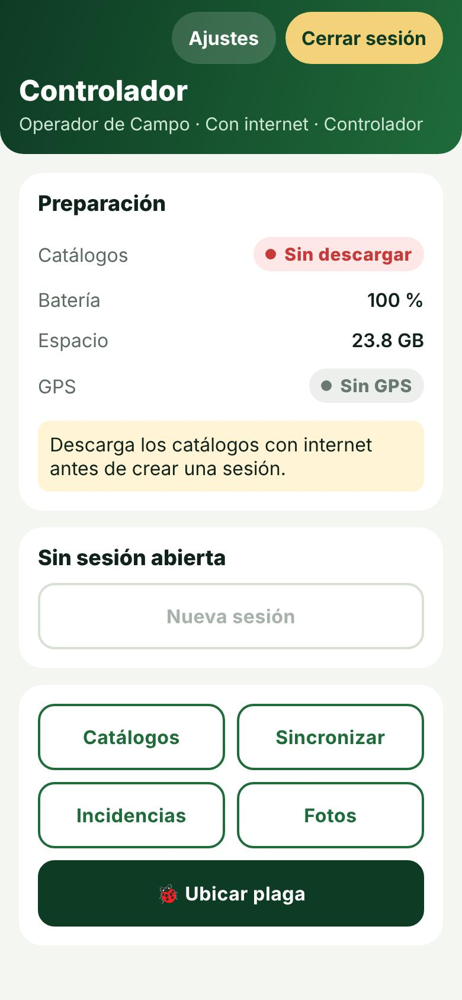

# Panel del controlador sin catálogos



| Dato | Valor |
|---|---|
| Archivo | `03-manuales/media/app/p10-20.jpeg` |
| Documento | Manual de usuario · App móvil (v0.6.1) |
| Sección | Controlador: panel y catálogos (línea 549 del manual) |
| Tipo | Captura de pantalla de la app (celular) |

## Qué muestra

Panel principal del controlador antes de descargar los catálogos. La sección «Preparación» marca los catálogos en rojo («Sin descargar») y avisa que hay que bajarlos con internet; por eso «Nueva sesión» aparece desactivado.

## Texto visible

Ajustes · Cerrar sesión · Controlador · Operador de Campo · Con internet · Controlador · Preparación: Catálogos ● Sin descargar · Batería 100 % · Espacio 23.8 GB · GPS ● Sin GPS · «Descarga los catálogos con internet antes de crear una sesión.» · Sin sesión abierta · [Nueva sesión] (desactivado) · [Catálogos] [Sincronizar] [Incidencias] [Fotos] · [Ubicar plaga]

<details><summary>Texto reconocido automáticamente (OCR, sin corregir)</summary>

```text
Ajustes
Controlador
Operador de Campo - Con internet - Controlador
Preparación
Catálogos e Sin descargar
Batería 100 %
Espacio 23.8 GB
GPS e Sin GPS
Descarga los catálogos con internet
antes de crear una sesión.
Sin sesión abierta
Catálogos
Incidencias
dx Ubicar plaga
```

</details>
