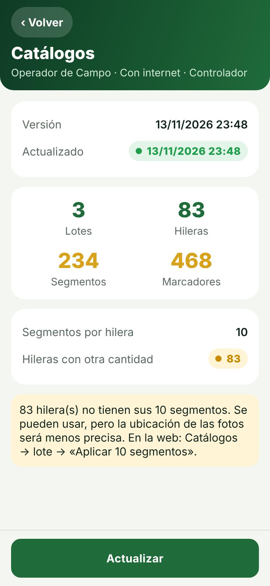

# Catálogos descargados



| Dato | Valor |
|---|---|
| Archivo | `03-manuales/media/app/p10-22.jpeg` |
| Documento | Manual de usuario · App móvil (v0.6.1) |
| Sección | Controlador: panel y catálogos (línea 559 del manual) |
| Tipo | Captura de pantalla de la app (celular) |

## Qué muestra

Pantalla «Catálogos» con la versión descargada y el resumen de lo que trae: lotes, hileras, segmentos y marcadores. Advierte que 83 hileras no tienen sus 10 segmentos y explica cómo corregirlo en la web.

## Texto visible

‹ Volver · Catálogos · Versión 13/11/2026 23:48 · Actualizado ● 13/11/2026 23:48 · 3 Lotes · 83 Hileras · 234 Segmentos · 468 Marcadores · Segmentos por hilera 10 · Hileras con otra cantidad ● 83 · «83 hilera(s) no tienen sus 10 segmentos. Se pueden usar, pero la ubicación de las fotos será menos precisa. En la web: Catálogos → lote → «Aplicar 10 segmentos».» · [Actualizar]

<details><summary>Texto reconocido automáticamente (OCR, sin corregir)</summary>

```text
< Volver
Catálogos
Operador de Campo - Con internet - Controlador
Versión 13/11/2026 23:48
Actualizado e 13/11/2026 23:48
3 83
Lotes Hileras
Segmentos Marcadores
Segmentos por hilera 10
Hileras con otra cantidad e 83
83 hilera(s) no tienen sus 10 segmentos. Se
pueden usar, pero la ubicación de las fotos
será menos precisa. En la web: Catálogos
> lote > «Aplicar 10 segmentos».
```

</details>
