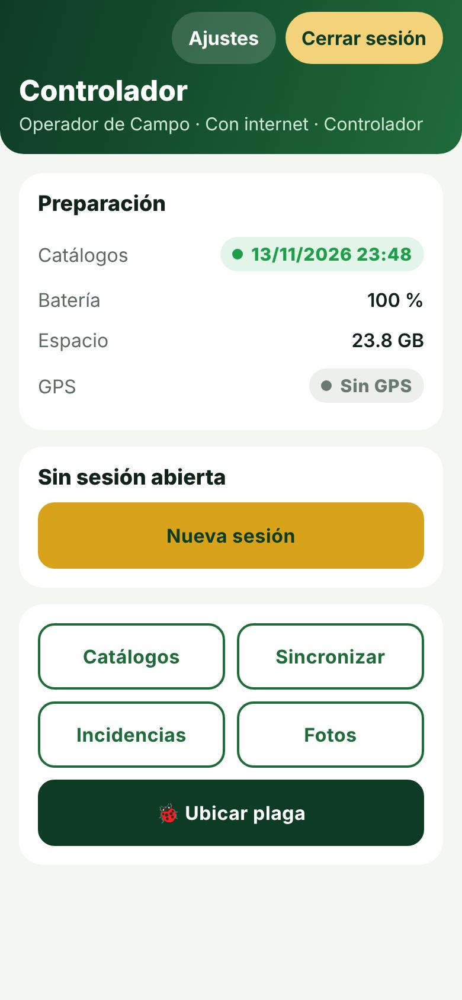

# Panel del controlador listo



| Dato | Valor |
|---|---|
| Archivo | `03-manuales/media/app/p11-24.jpeg` |
| Documento | Manual de usuario · App móvil (v0.6.1) |
| Sección | Controlador: panel y catálogos (línea 621 del manual) |
| Tipo | Captura de pantalla de la app (celular) |

## Qué muestra

Panel del controlador con los catálogos al día (fecha en verde). «Nueva sesión» ya está habilitado (botón amarillo).

## Texto visible

Ajustes · Cerrar sesión · Controlador · Preparación: Catálogos ● 13/11/2026 23:48 · Batería 100 % · Espacio 23.8 GB · GPS ● Sin GPS · Sin sesión abierta · [Nueva sesión] · [Catálogos] [Sincronizar] [Incidencias] [Fotos] · [Ubicar plaga]

<details><summary>Texto reconocido automáticamente (OCR, sin corregir)</summary>

```text
Ajustes Cerrar sesión
Controlador
Operador de Campo - Con internet - Controlador
Preparación
Catálogos e 13/11/2026 23:48
Batería 100 %
Espacio 23.8 GB
GPS e Sin GPS
Sin sesión abierta
Nueva sesión
Catálogos
Incidencias
¿ Ubicar plaga
```

</details>
