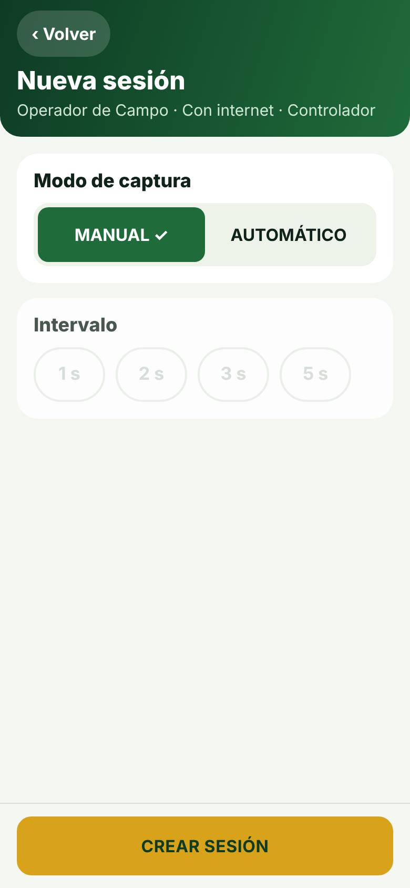

# Nueva sesión: modo de captura



| Dato | Valor |
|---|---|
| Archivo | `03-manuales/media/app/p12-27.jpeg` |
| Documento | Manual de usuario · App móvil (v0.6.1) |
| Sección | Nueva sesión y vincular las cámaras (línea 671 del manual) |
| Tipo | Captura de pantalla de la app (celular) |

## Qué muestra

Al crear la sesión se elige el modo de captura. En MANUAL el operador pulsa CAPTURAR en cada punto; en AUTOMÁTICO se elige un intervalo (1, 2, 3 o 5 s), que aquí aparece desactivado porque está marcado Manual.

## Texto visible

‹ Volver · Nueva sesión · Modo de captura: MANUAL ✓ | AUTOMÁTICO · Intervalo: 1 s · 2 s · 3 s · 5 s · [CREAR SESIÓN]

<details><summary>Texto reconocido automáticamente (OCR, sin corregir)</summary>

```text
< Volver
Nueva sesión
Operador de Campo - Con internet - Controlador
Modo de captura
MANUAL y AUTOMÁTICO
Intervalo
```

</details>
