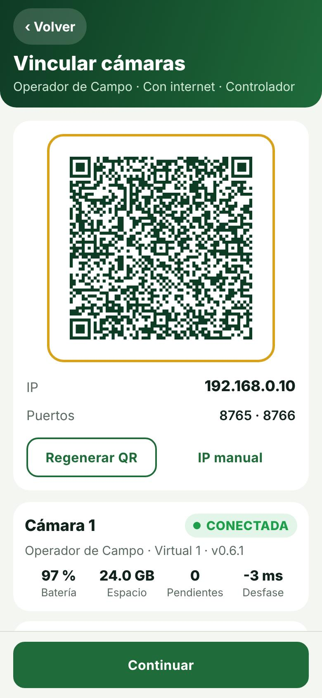

# Vincular cámaras (QR del controlador)



| Dato | Valor |
|---|---|
| Archivo | `03-manuales/media/app/p13-29.jpeg` |
| Documento | Manual de usuario · App móvil (v0.6.1) |
| Sección | Nueva sesión y vincular las cámaras (línea 739 del manual) |
| Tipo | Captura de pantalla de la app (celular) |

## Qué muestra

El controlador muestra un código QR con su IP y puertos para que las dos cámaras se vinculen por Wi-Fi local. Debajo lista cada cámara conectada con batería, espacio, fotos pendientes y desfase de reloj.

## Texto visible

‹ Volver · Vincular cámaras · [código QR] · IP 192.168.0.10 · Puertos 8765 · 8766 · [Regenerar QR] · IP manual · Cámara 1 ● CONECTADA · Operador de Campo · Virtual 1 · v0.6.1 · 97 % Batería · 24.0 GB Espacio · 0 Pendientes · -3 ms Desfase · [Continuar]

<details><summary>Texto reconocido automáticamente (OCR, sin corregir)</summary>

```text
< Volver
Vincular cámaras
Operador de Campo - Con internet - Controlador
IP 192.168.0.10
Puertos 8765 - 8766
Regenerar QR IP manual
Cámara 1 e CONECTADA
Operador de Campo - Virtual 1 - vO.6.1
97% 24.0 GB (0) -3 ms
Batería Espacio Pendientes Desfase
```

</details>
