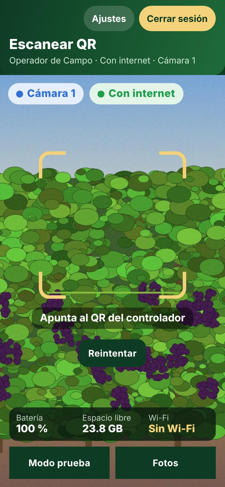

# Escanear QR desde la cámara



| Dato | Valor |
|---|---|
| Archivo | `03-manuales/media/app/p13-31.jpeg` |
| Documento | Manual de usuario · App móvil (v0.6.1) |
| Sección | Nueva sesión y vincular las cámaras (línea 753 del manual) |
| Tipo | Captura de pantalla de la app (celular) |

## Qué muestra

Vista del celular que hará de Cámara 1: la cámara apunta al QR del controlador (en la imagen se ve un viñedo simulado). Abajo muestra batería, espacio libre y estado de Wi-Fi, con accesos a «Modo prueba» y «Fotos».

## Texto visible

Ajustes · Cerrar sesión · Escanear QR · Operador de Campo · Con internet · Cámara 1 · ● Cámara 1 · ● Con internet · «Apunta al QR del controlador» · [Reintentar] · Batería 100 % · Espacio libre 23.8 GB · Wi-Fi Sin Wi-Fi · [Modo prueba] [Fotos]

<details><summary>Texto reconocido automáticamente (OCR, sin corregir)</summary>

```text
Ajustes E sesión
Escanear QR
Operador de Campo - Con internet - Cámara 1
e Con internet
o] DS
Apunta al GR del controlador
Reintentar
Batería Espacio libre Wi-Fi
100 % 23.8 GB Sin Wi-Fi
Modo prueba Fotos
```

</details>
