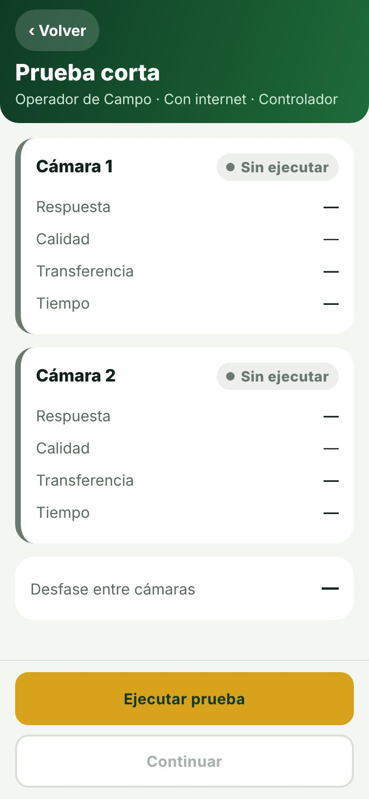

# Prueba corta (antes de ejecutar)



| Dato | Valor |
|---|---|
| Archivo | `03-manuales/media/app/p14-34.jpeg` |
| Documento | Manual de usuario · App móvil (v0.6.1) |
| Sección | Prueba corta (línea 829 del manual) |
| Tipo | Captura de pantalla de la app (celular) |

## Qué muestra

Prueba de conexión y calidad con las dos cámaras antes de salir al campo. Todas las métricas aparecen vacías porque la prueba no se ha ejecutado; «Continuar» está desactivado.

## Texto visible

‹ Volver · Prueba corta · Cámara 1 ● Sin ejecutar: Respuesta — · Calidad — · Transferencia — · Tiempo — · Cámara 2 ● Sin ejecutar: Respuesta — · Calidad — · Transferencia — · Tiempo — · Desfase entre cámaras — · [Ejecutar prueba] · [Continuar] (desactivado)

<details><summary>Texto reconocido automáticamente (OCR, sin corregir)</summary>

```text
< Volver
Prueba corta
Operador de Campo - Con internet - Controlador
Cámara 1 O Sin ejecutar
Respuesta NN
Calidad >
Transferencia =
Tiempo =
Cámara 2 O Sin ejecutar
Respuesta =
Calidad =
Transferencia =
Tiempo =
Desfase entre cámaras -
Continuar
```

</details>
