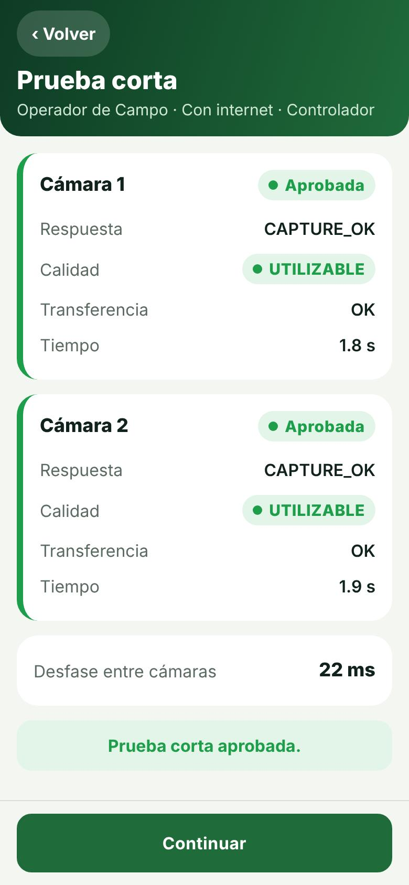

# Prueba corta aprobada



| Dato | Valor |
|---|---|
| Archivo | `03-manuales/media/app/p14-36.jpeg` |
| Documento | Manual de usuario · App móvil (v0.6.1) |
| Sección | Prueba corta (línea 835 del manual) |
| Tipo | Captura de pantalla de la app (celular) |

## Qué muestra

Resultado de la prueba: las dos cámaras respondieron CAPTURE_OK, la foto salió UTILIZABLE, la transferencia fue correcta y tardó menos de 2 s. El desfase entre cámaras es de 22 ms.

## Texto visible

Prueba corta · Cámara 1 ● Aprobada: Respuesta CAPTURE_OK · Calidad ● UTILIZABLE · Transferencia OK · Tiempo 1.8 s · Cámara 2 ● Aprobada: Respuesta CAPTURE_OK · Calidad ● UTILIZABLE · Transferencia OK · Tiempo 1.9 s · Desfase entre cámaras 22 ms · «Prueba corta aprobada.» · [Continuar]

<details><summary>Texto reconocido automáticamente (OCR, sin corregir)</summary>

```text
< Volver
Prueba corta
Operador de Campo - Con internet - Controlador
Cámara 1
Respuesta
Calidad
Transferencia
Tiempo
Cámara 2
Respuesta
Calidad
Transferencia
Tiempo
Desfase entre cámaras
e Aprobada
CAPTURE_OK
e UTILIZABLE
1.8 s
e Aprobada
CAPTURE_OK
e UTILIZABLE
1.9s
22 ms
Prueba corta aprobada.
```

</details>
