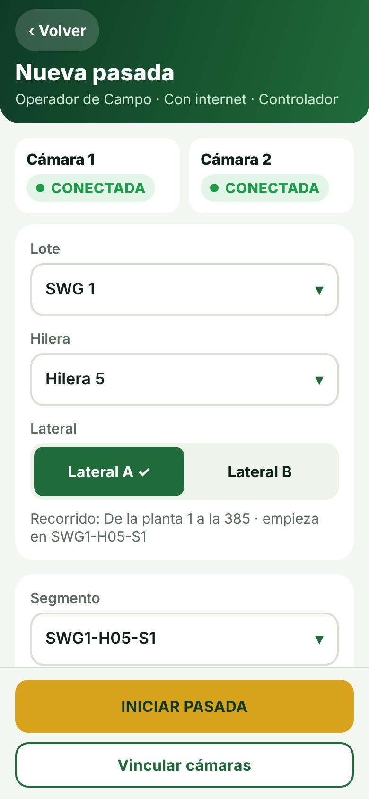

# Nueva pasada (Lateral A)



| Dato | Valor |
|---|---|
| Archivo | `03-manuales/media/app/p16-39.jpeg` |
| Documento | Manual de usuario · App móvil (v0.6.1) |
| Sección | Nueva pasada (línea 903 del manual) |
| Tipo | Captura de pantalla de la app (celular) |

## Qué muestra

Configuración de una pasada: con las dos cámaras conectadas se elige lote, hilera, lateral y segmento inicial. Con Lateral A el recorrido va de la planta 1 a la 385.

## Texto visible

‹ Volver · Nueva pasada · Cámara 1 ● CONECTADA · Cámara 2 ● CONECTADA · Lote: SWG 1 · Hilera: Hilera 5 · Lateral: Lateral A ✓ | Lateral B · «Recorrido: De la planta 1 a la 385 · empieza en SWG1-H05-S1» · Segmento: SWG1-H05-S1 · [INICIAR PASADA] · [Vincular cámaras]

<details><summary>Texto reconocido automáticamente (OCR, sin corregir)</summary>

```text
< Volver
Nueva pasada
Operador de Campo - Con internet - Controlador
Cámara 1 Cámara 2
e CONECTADA e CONECTADA
Lote
SWG 1 v
Hilera
Hilera 5 v
Lateral
Lateral A y Lateral B
Recorrido: De la planta 1 a la 385 - empieza
en SWG1-HO5-S1
Segmento
SWG1-HO5-S1 v
INICIAR PASADA
Vincular cámaras
```

</details>
