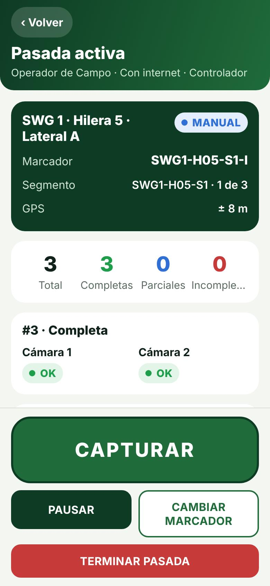

# Pasada activa: capturar



| Dato | Valor |
|---|---|
| Archivo | `03-manuales/media/app/p17-42.jpeg` |
| Documento | Manual de usuario · App móvil (v0.6.1) |
| Sección | Pasada activa: capturar (línea 1019 del manual) |
| Tipo | Captura de pantalla de la app (celular) |

## Qué muestra

Pantalla de trabajo durante la pasada. Arriba la ubicación actual (lote, hilera, lateral, marcador, segmento y precisión GPS); al centro los contadores de capturas y la última captura (#3, completa, las dos cámaras OK); abajo el botón grande CAPTURAR y los controles de pausa, cambio de marcador y fin.

## Texto visible

‹ Volver · Pasada activa · SWG 1 · Hilera 5 · Lateral A · ● MANUAL · Marcador SWG1-H05-S1-I · Segmento SWG1-H05-S1 · 1 de 3 · GPS ± 8 m · 3 Total · 3 Completas · 0 Parciales · 0 Incompletas · #3 · Completa · Cámara 1 ● OK · Cámara 2 ● OK · [CAPTURAR] · [PAUSAR] [CAMBIAR MARCADOR] · [TERMINAR PASADA]

<details><summary>Texto reconocido automáticamente (OCR, sin corregir)</summary>

```text
< Volver
Pasada activa
Operador de Campo - Con internet - Controlador
SWG 1 - Hilera 5 -
Lateral A
Marcador SWG1-HO5-S1-1
Segmento SWG1-HO5-S1 - 1 de 3
GPS :8m
3 3 0)
Total Completas Parciales Incomple...
F3 - Completa
Cámara 1 Cámara 2
e oK e oK
CAPTURAR
PAUSAR CAMBIAR
MARCADOR
```

</details>
