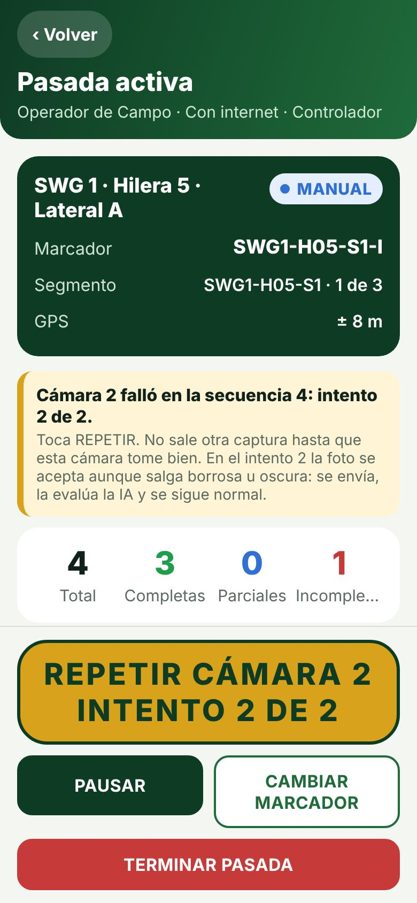

# Repetir cámara (intento 2 de 2)



| Dato | Valor |
|---|---|
| Archivo | `03-manuales/media/app/p18-47.jpeg` |
| Documento | Manual de usuario · App móvil (v0.6.1) |
| Sección | Si una foto sale mal: repetir (línea 1109 del manual) |
| Tipo | Captura de pantalla de la app (celular) |

## Qué muestra

Segundo y último intento. El aviso explica que esta foto se acepta aunque salga mala; la IA la evalúa y la pasada sigue.

## Texto visible

Pasada activa · «Cámara 2 falló en la secuencia 4: intento 2 de 2. Toca REPETIR. …» · 4 Total · 3 Completas · 0 Parciales · 1 Incompleta · [REPETIR CÁMARA 2 · INTENTO 2 DE 2] · [PAUSAR] [CAMBIAR MARCADOR] · [TERMINAR PASADA]

<details><summary>Texto reconocido automáticamente (OCR, sin corregir)</summary>

```text
< Volver
Pasada activa
Operador de Campo - Con internet - Controlador
SWG 1 - Hilera 5 -
Lateral A
Marcador SWG1-HO5-S1-1
Segmento SWG1-HO5-S1 - 1 de 3
GPS :8m
Cámara 2 falló en la secuencia 4: intento
2 de 2.
Toca REPETIR. No sale otra captura hasta que
esta cámara tome bien. En el intento 2 la foto se
acepta aunque salga borrosa u oscura: se envía,
la evalúa la lA y se sigue normal.
4 3 0)
Total Completas Parciales Incomple...
REPETIR CÁMARA 2
INTENTO 2 DE 2
PAUSAR CAMBIAR
MARCADOR
```

</details>
