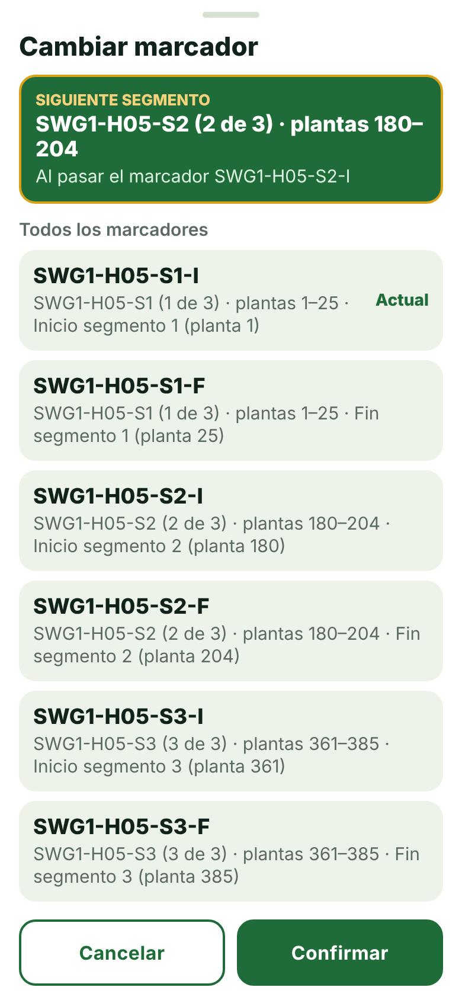

# Cambiar marcador



| Dato | Valor |
|---|---|
| Archivo | `03-manuales/media/app/p20-50.jpeg` |
| Documento | Manual de usuario · App móvil (v0.6.1) |
| Sección | Cambiar marcador y pausar (línea 1177 del manual) |
| Tipo | Captura de pantalla de la app (celular) |

## Qué muestra

Hoja inferior que se abre con «CAMBIAR MARCADOR». Arriba sugiere el siguiente segmento; abajo lista todos los marcadores de la hilera (inicio -I y fin -F de cada segmento, con su rango de plantas). El actual está marcado.

## Texto visible

Cambiar marcador · SIGUIENTE SEGMENTO: SWG1-H05-S2 (2 de 3) · plantas 180–204 · Al pasar el marcador SWG1-H05-S2-I · Todos los marcadores: SWG1-H05-S1-I · SWG1-H05-S1 (1 de 3) · plantas 1–25 · Inicio segmento 1 (planta 1) · Actual · SWG1-H05-S1-F · … Fin segmento 1 (planta 25) · SWG1-H05-S2-I · … plantas 180–204 · Inicio segmento 2 (planta 180) · SWG1-H05-S2-F · Fin segmento 2 (planta 204) · SWG1-H05-S3-I · … plantas 361–385 · Inicio segmento 3 (planta 361) · SWG1-H05-S3-F · Fin segmento 3 (planta 385) · [Cancelar] [Confirmar]

<details><summary>Texto reconocido automáticamente (OCR, sin corregir)</summary>

```text
Cambiar marcador
SWG1-HO5-S2 (2 de 3) - plantas 180-
204
Al pasar el marcador SWG1-HO5-S2-l
Todos los marcadores
SWG1-HO5-S1-1
SWG1-H05-S1 (1 de 3) - plantas 1-25 - Actual
Inicio segmento 1 (planta 1)
SWG1-HO5-S1-F
SWG1-HO05-S1 (1 de 3) : plantas 1-25 - Fin
segmento 1 (planta 25)
SWG1-HO5-S2-1
SWG1-H05-S2 (2 de 3) - plantas 180-204 -
Inicio segmento 2 (planta 180)
SWG1-HO5-S2-F
SWG1-H05-S2 (2 de 3) - plantas 180-204 - Fin
segmento 2 (planta 204)
SWG1-HO5-S3-1
SWG1-H0O5-S3 (3 de 3) - plantas 361-385 -
Inicio segmento 3 (planta 361)
SWG1-HO5-S3-F
SWG1-H05-S3 (3 de 3) - plantas 361-385 - Fin
segmento 3 (planta 385)
Cancelar Confirmar
```

</details>
