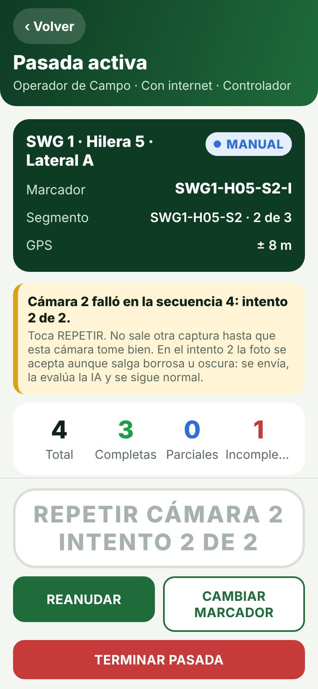

# Pasada en pausa



| Dato | Valor |
|---|---|
| Archivo | `03-manuales/media/app/p20-52.jpeg` |
| Documento | Manual de usuario · App móvil (v0.6.1) |
| Sección | Cambiar marcador y pausar (línea 1187 del manual) |
| Tipo | Captura de pantalla de la app (celular) |

## Qué muestra

Pasada pausada en el marcador SWG1-H05-S2-I (segmento 2 de 3). El botón de repetir queda gris y aparece «REANUDAR».

## Texto visible

Pasada activa · SWG 1 · Hilera 5 · Lateral A · MANUAL · Marcador SWG1-H05-S2-I · Segmento SWG1-H05-S2 · 2 de 3 · GPS ± 8 m · aviso de Cámara 2 intento 2 de 2 · 4 Total · 3 Completas · 0 Parciales · 1 Incompleta · [REPETIR CÁMARA 2 · INTENTO 2 DE 2] (gris) · [REANUDAR] [CAMBIAR MARCADOR] · [TERMINAR PASADA]

<details><summary>Texto reconocido automáticamente (OCR, sin corregir)</summary>

```text
< Volver
Pasada activa
Operador de Campo - Con internet - Controlador
SWG 1 - Hilera 5 -
Lateral A
Marcador SWG1-HO5-S2-]
Segmento SWG1-HO5-S2 - 2 de 3
GPS :8m
Cámara 2 falló en la secuencia 4: intento
2 de 2.
Toca REPETIR. No sale otra captura hasta que
esta cámara tome bien. En el intento 2 la foto se
acepta aunque salga borrosa u oscura: se envía,
la evalúa la lA y se sigue normal.
4 3 0)
Total Completas Parciales Incomple...
REANUDAR CAMBIAR
MARCADOR
```

</details>
