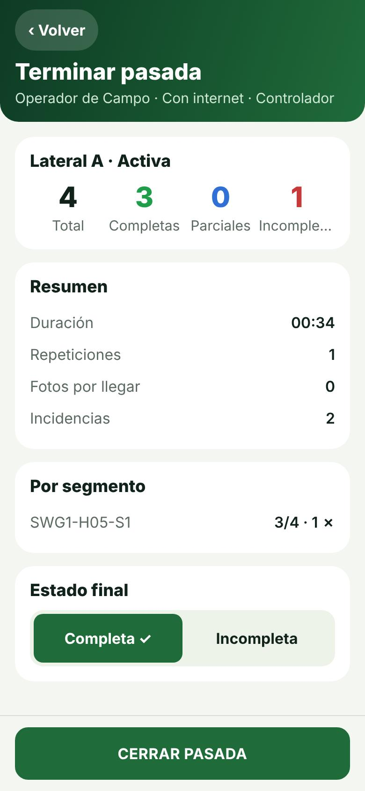

# Terminar pasada (resumen)



| Dato | Valor |
|---|---|
| Archivo | `03-manuales/media/app/p22-55.jpeg` |
| Documento | Manual de usuario · App móvil (v0.6.1) |
| Sección | Terminar la pasada y seguir (línea 1255 del manual) |
| Tipo | Captura de pantalla de la app (celular) |

## Qué muestra

Resumen antes de cerrar la pasada: contadores, duración, repeticiones, fotos por llegar, incidencias y avance por segmento. El operador elige el estado final (Completa o Incompleta).

## Texto visible

‹ Volver · Terminar pasada · Lateral A · Activa · 4 Total · 3 Completas · 0 Parciales · 1 Incompleta · Resumen: Duración 00:34 · Repeticiones 1 · Fotos por llegar 0 · Incidencias 2 · Por segmento: SWG1-H05-S1 3/4 · 1 × · Estado final: Completa ✓ | Incompleta · [CERRAR PASADA]

<details><summary>Texto reconocido automáticamente (OCR, sin corregir)</summary>

```text
< Volver
Terminar pasada
Operador de Campo - Con internet - Controlador
Lateral A - Activa
4 3 0 1
Total Completas Parciales Incomple...
Resumen
Duración 00:34
Repeticiones 1
Fotos por llegar (0)
Incidencias 2
Por segmento
SWG1-HO5-S1 3/4-1x
Estado final
Completa y Incompleta
CERRAR PASADA
```

</details>
