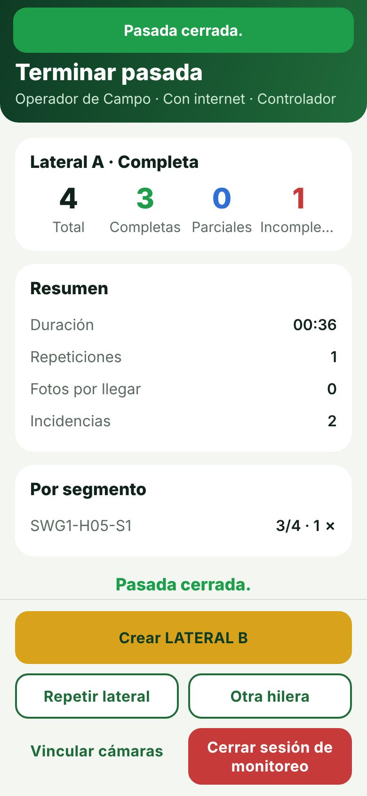

# Pasada cerrada: qué sigue



| Dato | Valor |
|---|---|
| Archivo | `03-manuales/media/app/p22-57.jpeg` |
| Documento | Manual de usuario · App móvil (v0.6.1) |
| Sección | Terminar la pasada y seguir (línea 1265 del manual) |
| Tipo | Captura de pantalla de la app (celular) |

## Qué muestra

Confirmación de pasada cerrada. Ofrece los siguientes pasos: crear el Lateral B de la misma hilera, repetir el lateral, pasar a otra hilera, volver a vincular cámaras o cerrar la sesión de monitoreo.

## Texto visible

Pasada cerrada. · Terminar pasada · Lateral A · Completa · 4 · 3 · 0 · 1 · Resumen: Duración 00:36 · Repeticiones 1 · Fotos por llegar 0 · Incidencias 2 · Por segmento: SWG1-H05-S1 3/4 · 1 × · «Pasada cerrada.» · [Crear LATERAL B] · [Repetir lateral] [Otra hilera] · Vincular cámaras · [Cerrar sesión de monitoreo]

<details><summary>Texto reconocido automáticamente (OCR, sin corregir)</summary>

```text
Pasada cerrada.
Terminar pasada
Operador de Campo - Con internet - Controlador
Lateral A - Completa
4 3 0
Total Completas Parciales Incomple...
Resumen
Duración 00:36
Repeticiones 1
Fotos por llegar 0
Incidencias 2
Por segmento
SWG1-H05-S1 3/4-1x
Pasada cerrada.
Crear LATERAL B
Repetir lateral Otra hilera
Vincular cámaras
```

</details>
