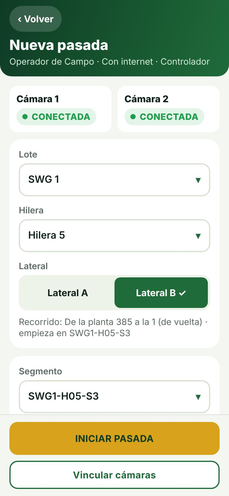

# Nueva pasada (Lateral B, de vuelta)



| Dato | Valor |
|---|---|
| Archivo | `03-manuales/media/app/p23-59.jpeg` |
| Documento | Manual de usuario · App móvil (v0.6.1) |
| Sección | Terminar la pasada y seguir (línea 1305 del manual) |
| Tipo | Captura de pantalla de la app (celular) |

## Qué muestra

Pasada del Lateral B de la misma hilera. El recorrido se invierte: de la planta 385 a la 1, empezando en el segmento S3.

## Texto visible

Nueva pasada · Cámara 1 ● CONECTADA · Cámara 2 ● CONECTADA · Lote SWG 1 · Hilera 5 · Lateral A | Lateral B ✓ · «Recorrido: De la planta 385 a la 1 (de vuelta) · empieza en SWG1-H05-S3» · Segmento SWG1-H05-S3 · [INICIAR PASADA] · [Vincular cámaras]

<details><summary>Texto reconocido automáticamente (OCR, sin corregir)</summary>

```text
< Volver
Nueva pasada
Operador de Campo - Con internet - Controlador
Cámara 1 Cámara 2
e CONECTADA e CONECTADA
Lote
SWG 1 v
Hilera
Hilera 5 v
Lateral
Lateral A Lateral B y
Recorrido: De la planta 385 a la 1 (de vuelta) -
empieza en SWG1-HO5-S3
Segmento
SWG1-HO5-S3 v
INICIAR PASADA
Vincular cámaras
```

</details>
