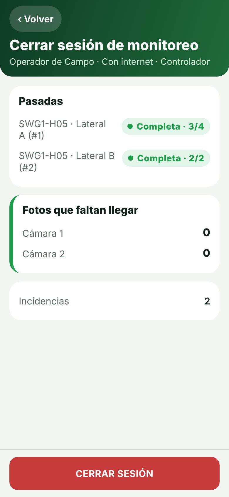

# Cerrar sesión de monitoreo



| Dato | Valor |
|---|---|
| Archivo | `03-manuales/media/app/p24-62.jpeg` |
| Documento | Manual de usuario · App móvil (v0.6.1) |
| Sección | Cerrar la sesión de monitoreo (línea 1345 del manual) |
| Tipo | Captura de pantalla de la app (celular) |

## Qué muestra

Resumen final de la sesión: las pasadas hechas con su estado, las fotos de cada cámara que faltan llegar al controlador y el número de incidencias.

## Texto visible

‹ Volver · Cerrar sesión de monitoreo · Pasadas: SWG1-H05 · Lateral A (#1) ● Completa · 3/4 · SWG1-H05 · Lateral B (#2) ● Completa · 2/2 · Fotos que faltan llegar: Cámara 1 0 · Cámara 2 0 · Incidencias 2 · [CERRAR SESIÓN]

<details><summary>Texto reconocido automáticamente (OCR, sin corregir)</summary>

```text
< Volver
Cerrar sesión de monitoreo
Operador de Campo - Con internet - Controlador
Pasadas
SWG1-HOS - Lateral e Completa - 3/4
A (+1)
SWG1-HOS : Lateral B_ e Completa - 2/2
(42)
Fotos que faltan llegar
Cámara 1 (0)
Cámara 2 (0)
Incidencias 2
CERRAR SESIÓN
```

</details>
