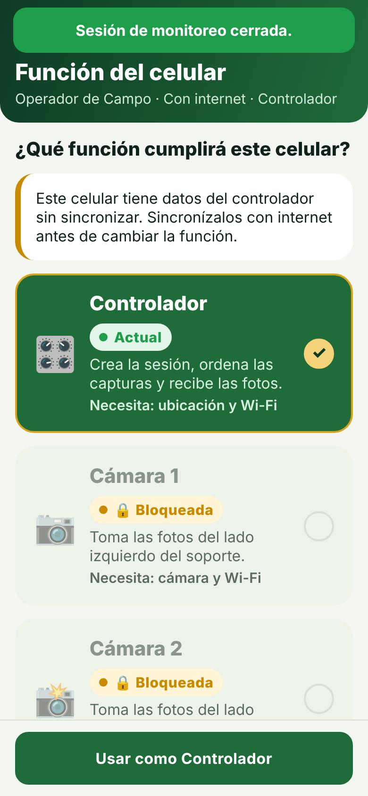

# Sesión cerrada con datos sin sincronizar



| Dato | Valor |
|---|---|
| Archivo | `03-manuales/media/app/p24-64.jpeg` |
| Documento | Manual de usuario · App móvil (v0.6.1) |
| Sección | Cerrar la sesión de monitoreo (línea 1353 del manual) |
| Tipo | Captura de pantalla de la app (celular) |

## Qué muestra

Tras cerrar la sesión vuelve a «Función del celular». Como el controlador tiene datos sin subir, la app bloquea el cambio a Cámara 1 o 2 hasta sincronizar.

## Texto visible

Sesión de monitoreo cerrada. · Función del celular · «Este celular tiene datos del controlador sin sincronizar. Sincronízalos con internet antes de cambiar la función.» · Controlador ● Actual ✓ · Cámara 1 ● 🔒 Bloqueada · Cámara 2 ● 🔒 Bloqueada · [Usar como Controlador]

<details><summary>Texto reconocido automáticamente (OCR, sin corregir)</summary>

```text
Sesión de monitoreo cerrada.
Función del celular
Operador de Campo - Con internet - Controlador
¿Qué función cumplirá este celular?
Este celular tiene datos del controlador
sin sincronizar. Sincronízalos con internet
antes de cambiar la función.
Controlador
Crea la sesión, ordena las
capturas y recibe las fotos.
Necesita: ubicación y Wi-Fi
(OÍ Toma las fotos del lado
izquierdo del soporte.
Necesita: cámara y Wi-Fi
OÍ Toma las fotos del lado
Usar como Controlador
```

</details>
