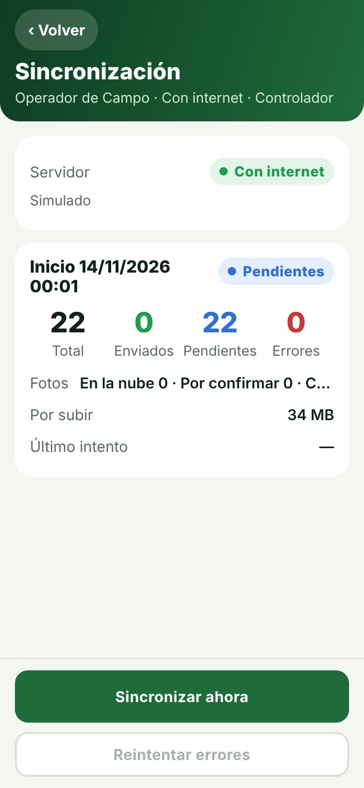

# Sincronización pendiente



| Dato | Valor |
|---|---|
| Archivo | `03-manuales/media/app/p25-67.jpeg` |
| Documento | Manual de usuario · App móvil (v0.6.1) |
| Sección | Sincronizar (línea 1397 del manual) |
| Tipo | Captura de pantalla de la app (celular) |

## Qué muestra

Pantalla de sincronización con el servidor (aquí simulado). La sesión del 14/11/2026 tiene 22 elementos pendientes y 34 MB por subir.

## Texto visible

‹ Volver · Sincronización · Servidor ● Con internet · Simulado · Inicio 14/11/2026 00:01 ● Pendientes · 22 Total · 0 Enviados · 22 Pendientes · 0 Errores · Fotos: En la nube 0 · Por confirmar 0 · C… · Por subir 34 MB · Último intento — · [Sincronizar ahora] · [Reintentar errores] (desactivado)

<details><summary>Texto reconocido automáticamente (OCR, sin corregir)</summary>

```text
< Volver
Sincronización
Operador de Campo - Con internet - Controlador
Servidor e Con internet
Simulado
Inicio 14/11/2026 elPendientes
00:01
Total Enviados Pendientes Errores
Fotos En la nube O - Por confirmar 0 - C...
Por subir 34 MB
Último intento —
Sincronizar ahora
```

</details>
