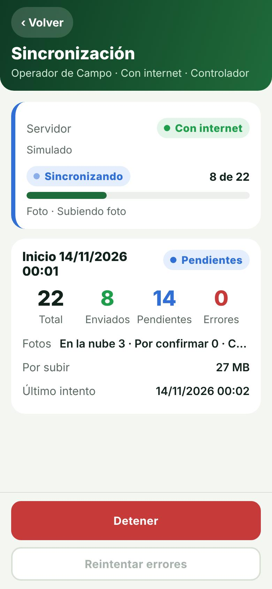

# Sincronización en curso



| Dato | Valor |
|---|---|
| Archivo | `03-manuales/media/app/p25-69.jpeg` |
| Documento | Manual de usuario · App móvil (v0.6.1) |
| Sección | Sincronizar (línea 1405 del manual) |
| Tipo | Captura de pantalla de la app (celular) |

## Qué muestra

Subida en progreso: barra «Sincronizando 8 de 22», 8 enviados y 14 pendientes, 27 MB por subir. El botón principal cambia a «Detener».

## Texto visible

Sincronización · Servidor ● Con internet · Simulado · ● Sincronizando 8 de 22 · Foto · Subiendo foto · Inicio 14/11/2026 00:01 ● Pendientes · 22 Total · 8 Enviados · 14 Pendientes · 0 Errores · Fotos: En la nube 3 · Por confirmar 0 · C… · Por subir 27 MB · Último intento 14/11/2026 00:02 · [Detener] · [Reintentar errores]

<details><summary>Texto reconocido automáticamente (OCR, sin corregir)</summary>

```text
< Volver
Sincronización
Operador de Campo - Con internet - Controlador
Servidor e Con internet
Simulado
e Sincronizando 8 de 22
Foto - Subiendo foto
Inicio 14/11/2026 e Pendientes
00:01
22 8 14 O
Total Enviados Pendientes Errores
Fotos En la nube 3 - Por confirmar O : C...
Por subir 27 MB
Último intento 14/11/2026 00:02
```

</details>
