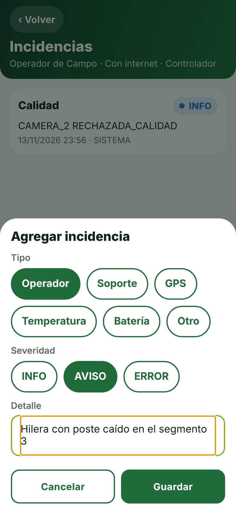

# Agregar incidencia



| Dato | Valor |
|---|---|
| Archivo | `03-manuales/media/app/p27-72.jpeg` |
| Documento | Manual de usuario · App móvil (v0.6.1) |
| Sección | Incidencias, fotos guardadas y ajustes (línea 1491 del manual) |
| Tipo | Captura de pantalla de la app (celular) |

## Qué muestra

Formulario para registrar una incidencia de campo. Se elige el tipo (Operador, Soporte, GPS, Temperatura, Batería, Otro), la severidad (INFO, AVISO, ERROR) y un detalle. Detrás se ve una incidencia automática del sistema por calidad rechazada.

## Texto visible

Incidencias · (fondo) Calidad ● INFO · CAMERA_2 RECHAZADA_CALIDAD · 13/11/2026 23:56 · SISTEMA · Agregar incidencia · Tipo: Operador ✓ · Soporte · GPS · Temperatura · Batería · Otro · Severidad: INFO · AVISO ✓ · ERROR · Detalle: «Hilera con poste caído en el segmento 3» · [Cancelar] [Guardar]

<details><summary>Texto reconocido automáticamente (OCR, sin corregir)</summary>

```text
Agregar incidencia
Tipo
Severidad
Detalle
```

</details>
