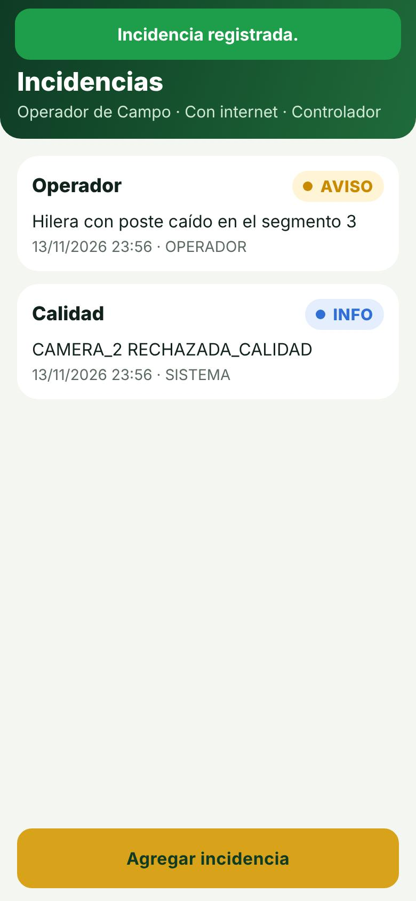

# Incidencias registradas



| Dato | Valor |
|---|---|
| Archivo | `03-manuales/media/app/p27-74.jpeg` |
| Documento | Manual de usuario · App móvil (v0.6.1) |
| Sección | Incidencias, fotos guardadas y ajustes (línea 1503 del manual) |
| Tipo | Captura de pantalla de la app (celular) |

## Qué muestra

Lista de incidencias de la sesión: la que acaba de registrar el operador (AVISO) y la generada por el sistema (INFO).

## Texto visible

Incidencia registrada. · Incidencias · Operador ● AVISO · Hilera con poste caído en el segmento 3 · 13/11/2026 23:56 · OPERADOR · Calidad ● INFO · CAMERA_2 RECHAZADA_CALIDAD · 13/11/2026 23:56 · SISTEMA · [Agregar incidencia]

<details><summary>Texto reconocido automáticamente (OCR, sin corregir)</summary>

```text
Incidencia registrada.
Incidencias
Operador de Campo - Con internet - Controlador
Operador e AVISO
Hilera con poste caído en el segmento 3
13/11/2026 23:56 - OPERADOR
Calidad e INFO
CAMERA_2 RECHAZADA_CALIDAD
13/11/2026 23:56 - SISTEMA
```

</details>
