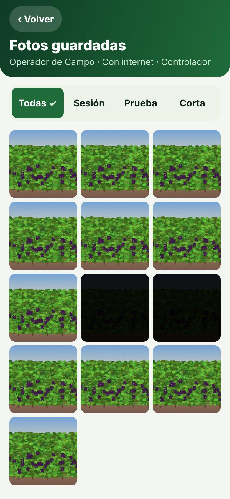

# Fotos guardadas



| Dato | Valor |
|---|---|
| Archivo | `03-manuales/media/app/p28-76.jpeg` |
| Documento | Manual de usuario · App móvil (v0.6.1) |
| Sección | Fotos guardadas y ajustes (línea 1561 del manual) |
| Tipo | Captura de pantalla de la app (celular) |

## Qué muestra

Galería de fotos guardadas en el celular, con filtros Todas, Sesión, Prueba y Corta. Dos miniaturas aparecen oscuras: son las fotos rechazadas por calidad.

## Texto visible

‹ Volver · Fotos guardadas · Todas ✓ · Sesión · Prueba · Corta · [cuadrícula de 13 miniaturas de vid; 2 oscuras]

<details><summary>Texto reconocido automáticamente (OCR, sin corregir)</summary>

```text
< Volver
Fotos guardadas
Operador de Campo - Con internet - Controlador
Sesión Prueba Corta
```

</details>
