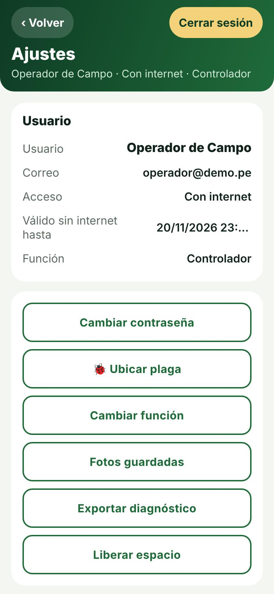

# Ajustes



| Dato | Valor |
|---|---|
| Archivo | `03-manuales/media/app/p28-78.jpeg` |
| Documento | Manual de usuario · App móvil (v0.6.1) |
| Sección | Fotos guardadas y ajustes (línea 1567 del manual) |
| Tipo | Captura de pantalla de la app (celular) |

## Qué muestra

Pantalla de ajustes con los datos del usuario y la vigencia del acceso sin internet, más las acciones de mantenimiento del equipo.

## Texto visible

‹ Volver · Cerrar sesión · Ajustes · Usuario: Operador de Campo · Correo operador@demo.pe · Acceso Con internet · Válido sin internet hasta 20/11/2026 23:… · Función Controlador · [Cambiar contraseña] · [Ubicar plaga] · [Cambiar función] · [Fotos guardadas] · [Exportar diagnóstico] · [Liberar espacio]

<details><summary>Texto reconocido automáticamente (OCR, sin corregir)</summary>

```text
< Volver
Ajustes
Operador de Campo - Con internet - Controlador
Usuario
Usuario Operador de Campo
Correo operadorQOdemo.pe
Acceso Con internet
Válido sin internet 20/11/2026 23:...
hasta
Función Controlador
Cambiar contraseña
% Ubicar plaga
Cambiar función
Fotos guardadas
Exportar diagnóstico
Liberar espacio
```

</details>
