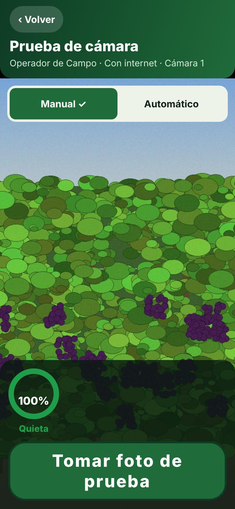

# Prueba de cámara (antes de tomar la foto)



| Dato | Valor |
|---|---|
| Archivo | `03-manuales/media/app/p29-81.jpeg` |
| Documento | Manual de usuario · App móvil (v0.6.1) |
| Sección | Funciones de cámara (línea 1609 del manual) |
| Tipo | Captura de pantalla de la app (celular) |

## Qué muestra

Modo prueba de una cámara (Cámara 1). El indicador circular «100 % Quieta» mide si el celular está estable; el botón toma una foto de prueba sin abrir sesión.

## Texto visible

‹ Volver · Prueba de cámara · Operador de Campo · Con internet · Cámara 1 · Manual ✓ | Automático · [vista de cámara sobre viñedo simulado] · 100 % Quieta · [Tomar foto de prueba]

<details><summary>Texto reconocido automáticamente (OCR, sin corregir)</summary>

```text
< Volver
Prueba de cámara
Operador de Campo - Con internet - Cámara 1
100%
Tomar foto de
prueba
```

</details>
