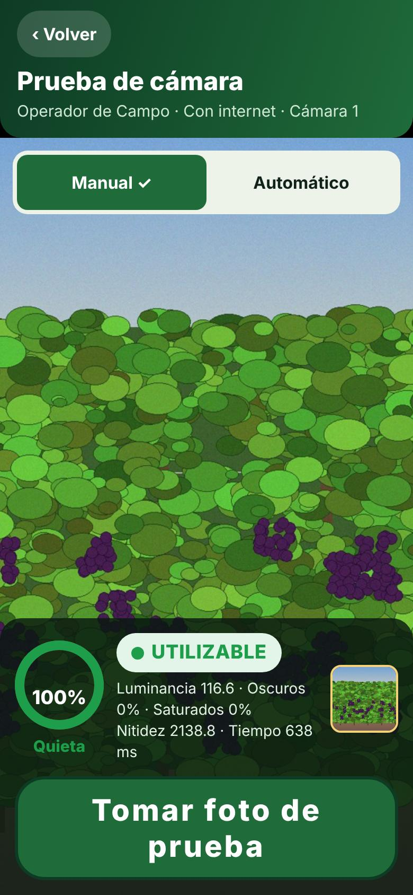

# Prueba de cámara con resultado



| Dato | Valor |
|---|---|
| Archivo | `03-manuales/media/app/p29-83.jpeg` |
| Documento | Manual de usuario · App móvil (v0.6.1) |
| Sección | Funciones de cámara (línea 1615 del manual) |
| Tipo | Captura de pantalla de la app (celular) |

## Qué muestra

Resultado de la foto de prueba: la validación local la marca UTILIZABLE y muestra las métricas que usa (luminancia, oscuros, saturados, nitidez y tiempo), con la miniatura de la foto.

## Texto visible

Prueba de cámara · Manual ✓ | Automático · 100 % Quieta · ● UTILIZABLE · Luminancia 116.6 · Oscuros 0% · Saturados 0% · Nitidez 2138.8 · Tiempo 638 ms · [miniatura] · [Tomar foto de prueba]

<details><summary>Texto reconocido automáticamente (OCR, sin corregir)</summary>

```text
< Volver
Prueba de cámara
Operador de Campo - Con internet - Cámara 1
e UTILIZABLE
Luminancia 116.6 - Oscuros
100%
2/7 0% - Saturados 0%
Nitidez 2138.8 - Tiempo 638
Tomar foto de
prueba
```

</details>
