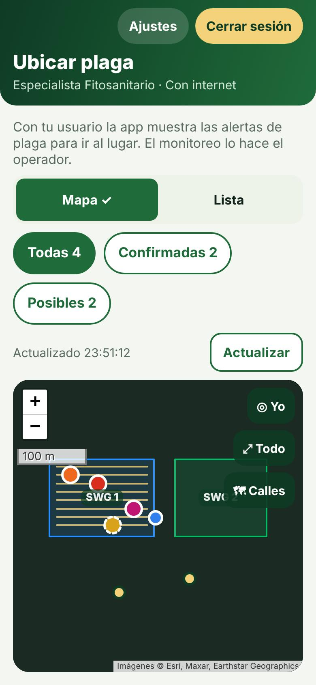

# Ubicar plaga: mapa (especialista)



| Dato | Valor |
|---|---|
| Archivo | `03-manuales/media/app/p31-86.jpeg` |
| Documento | Manual de usuario · App móvil (v0.6.1) |
| Sección | Ubicar plaga (línea 1677 del manual) |
| Tipo | Captura de pantalla de la app (celular) |

## Qué muestra

Vista «Ubicar plaga» con usuario de especialista. Explica que sirve para ir al lugar de las alertas, no para monitorear. Muestra filtros (Todas 4, Confirmadas 2, Posibles 2) y un mapa satelital con el lote SWG 1, sus hileras y puntos de colores por alerta; el punto azul es la posición del usuario.

## Texto visible

Ajustes · Cerrar sesión · Ubicar plaga · Especialista Fitosanitario · Con internet · «Con tu usuario la app muestra las alertas de plaga para ir al lugar. El monitoreo lo hace el operador.» · Mapa ✓ | Lista · Todas 4 · Confirmadas 2 · Posibles 2 · Actualizado 23:51:12 · [Actualizar] · [mapa: + − · 100 m · Yo · Todo · Calles · SWG 1 · SW… · Imágenes © Esri, Maxar, Earthstar Geographics]

<details><summary>Texto reconocido automáticamente (OCR, sin corregir)</summary>

```text
Ajustes
Ubicar plaga
Especialista Fitosanitario - Con internet
Con tu usuario la app muestra las alertas de
plaga para ir al lugar. El monitoreo lo hace el
operador.
Actualizado 23:51:12
Y Todo
sw FF Calles
Imágenes O Esri, Maxar, Earthstar Geographics
```

</details>
