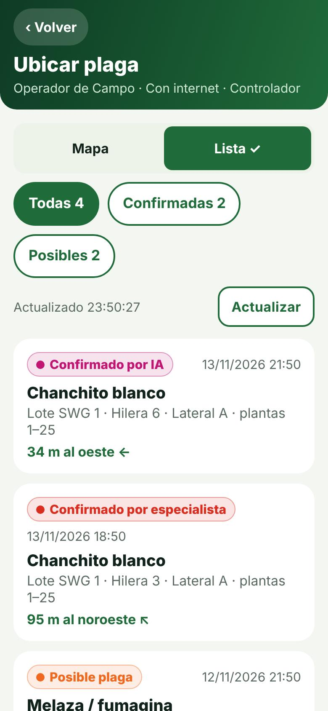

# Ubicar plaga: lista



| Dato | Valor |
|---|---|
| Archivo | `03-manuales/media/app/p31-88.jpeg` |
| Documento | Manual de usuario · App móvil (v0.6.1) |
| Sección | Ubicar plaga (línea 1683 del manual) |
| Tipo | Captura de pantalla de la app (celular) |

## Qué muestra

La misma información en modo lista. Cada tarjeta trae el estado (Confirmado por IA, Confirmado por especialista, Posible plaga), la plaga, la ubicación (lote, hilera, lateral, plantas) y la distancia y dirección desde el usuario.

## Texto visible

Ubicar plaga · Operador de Campo · Con internet · Controlador · Mapa | Lista ✓ · Todas 4 · Confirmadas 2 · Posibles 2 · Actualizado 23:50:27 · [Actualizar] · ● Confirmado por IA · 13/11/2026 21:50 · Chanchito blanco · Lote SWG 1 · Hilera 6 · Lateral A · plantas 1–25 · 34 m al oeste ← · ● Confirmado por especialista · 13/11/2026 18:50 · Chanchito blanco · Lote SWG 1 · Hilera 3 · Lateral A · plantas 1–25 · 95 m al noroeste ↖ · ● Posible plaga · 12/11/2026 21:50 · Melaza / fumagina

<details><summary>Texto reconocido automáticamente (OCR, sin corregir)</summary>

```text
< Volver
Ubicar plaga
Operador de Campo - Con internet - Controlador
Confirmadas 2
Posibles 2
Actualizado 23:50:27
(e Confirmado porlA ) — 13/11/2026 21:50
Chanchito blanco
Lote SWG 1: Hilera 6 - Lateral A - plantas
1-25
34 m al oeste <
( e Confirmado por especialista )
13/11/2026 18:50
Chanchito blanco
Lote SWG 1 : Hilera 3 - Lateral A - plantas
125
95 mal noroeste £
O Posible plaga 12/11/2026 21:50
Melaza / fumaaina
```

</details>
