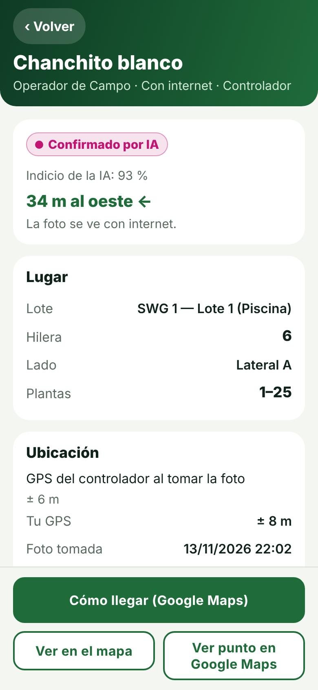

# Detalle de una alerta



| Dato | Valor |
|---|---|
| Archivo | `03-manuales/media/app/p32-90.jpeg` |
| Documento | Manual de usuario · App móvil (v0.6.1) |
| Sección | Ubicar plaga (línea 1737 del manual) |
| Tipo | Captura de pantalla de la app (celular) |

## Qué muestra

Detalle de la alerta de chanchito blanco confirmada por la IA (93 %). Indica dónde está (lote, hilera, lado, plantas), la precisión del GPS al tomar la foto y ofrece abrir la ruta en Google Maps o el punto en el mapa.

## Texto visible

‹ Volver · Chanchito blanco · ● Confirmado por IA · Indicio de la IA: 93 % · 34 m al oeste ← · «La foto se ve con internet.» · Lugar: Lote SWG 1 — Lote 1 (Piscina) · Hilera 6 · Lado Lateral A · Plantas 1–25 · Ubicación: GPS del controlador al tomar la foto ± 6 m · Tu GPS ± 8 m · Foto tomada 13/11/2026 22:02 · [Cómo llegar (Google Maps)] · [Ver en el mapa] [Ver punto en Google Maps]

<details><summary>Texto reconocido automáticamente (OCR, sin corregir)</summary>

```text
< Volver
Chanchito blanco
Operador de Campo - Con internet - Controlador
(e Confirmado por lA)
Indicio de la lA: 93 %
34 mal oeste <
La foto se ve con internet.
Lugar
Lote SWG 1— Lote 1 (Piscina)
Hilera 6
Lado Lateral A
Plantas 1-25
Ubicación
GPS del controlador al tomar la foto
:z6m
Tu GPS :z8gm
Foto tomada 13/11/2026 22:02
Cómo llegar (Google Maps)
Google Maps
```

</details>
