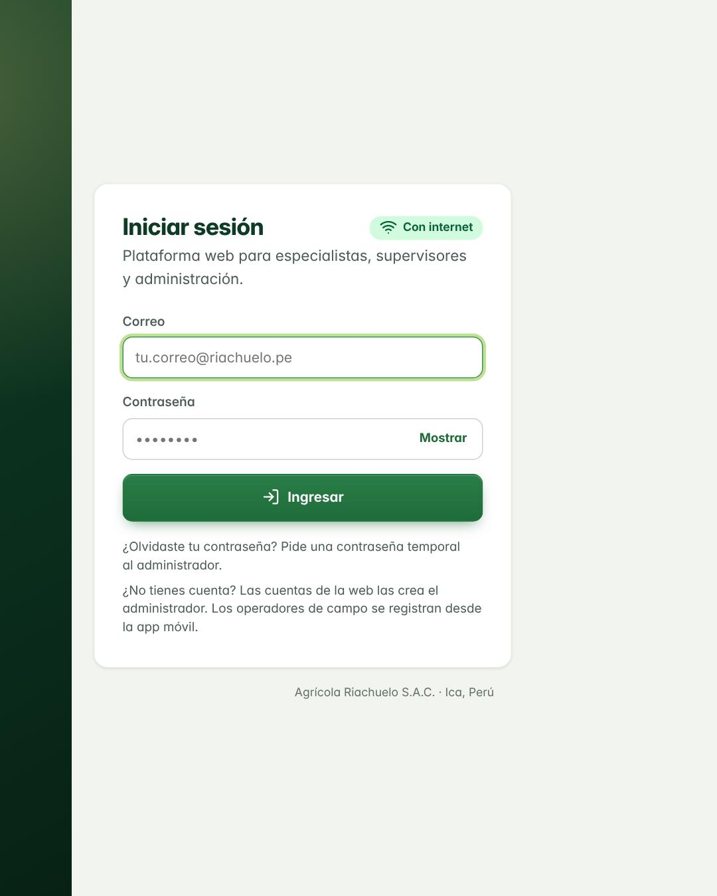

# Inicio de sesión de la web



| Dato | Valor |
|---|---|
| Archivo | `03-manuales/media/web/p05-07.jpeg` |
| Documento | Manual de usuario · Plataforma web (v1.6.1) |
| Sección | Ingresar, cambiar la contraseña y salir (línea 373 del manual) |
| Tipo | Captura de pantalla de la plataforma web |

## Qué muestra

Pantalla de ingreso de la plataforma web: una tarjeta blanca sobre fondo claro con franja verde a la izquierda. Aclara que las cuentas web las crea el administrador y que los operadores de campo se registran desde la app.

## Texto visible

Iniciar sesión · Con internet · Plataforma web para especialistas, supervisores y administración. · Correo [tu.correo@riachuelo.pe] · Contraseña [••••••••] Mostrar · [Ingresar] · ¿Olvidaste tu contraseña? Pide una contraseña temporal al administrador. · ¿No tienes cuenta? Las cuentas de la web las crea el administrador. Los operadores de campo se registran desde la app móvil. · Agrícola Riachuelo S.A.C. · Ica, Perú

<details><summary>Texto reconocido automáticamente (OCR, sin corregir)</summary>

```text
Iniciar sesión 2 Con internet
Plataforma web para especialistas, supervisores
y administración.
Correo
tu.correoQriachuelo.pe
Contraseña
Mostrar
3] Ingresar
¿Olvidaste tu contraseña? Pide una contraseña temporal
al administrador.
¿No tienes cuenta? Las cuentas de la web las crea el
administrador. Los operadores de campo se registran desde
la app móvil.
Agrícola Riachuelo S.A.C. - Ica, Perú
```

</details>
