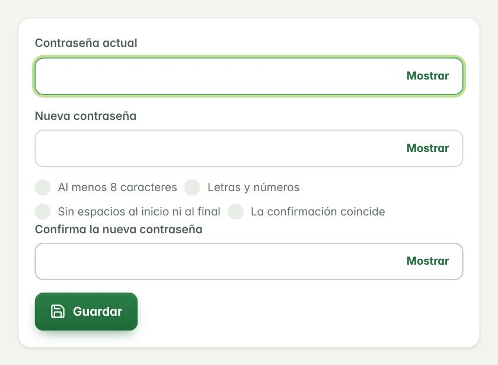

# Cambiar contraseña



| Dato | Valor |
|---|---|
| Archivo | `03-manuales/media/web/p06-11.jpeg` |
| Documento | Manual de usuario · Plataforma web (v1.6.1) |
| Sección | Salir (línea 471 del manual) |
| Tipo | Captura de pantalla de la plataforma web |

## Qué muestra

Formulario para cambiar la contraseña (obligatorio en el primer ingreso con contraseña temporal). Las cuatro reglas se marcan en vivo mientras se escribe.

## Texto visible

Contraseña actual [Mostrar] · Nueva contraseña [Mostrar] · ○ Al menos 8 caracteres · ○ Letras y números · ○ Sin espacios al inicio ni al final · ○ La confirmación coincide · Confirma la nueva contraseña [Mostrar] · [Guardar]

<details><summary>Texto reconocido automáticamente (OCR, sin corregir)</summary>

```text
Contraseña actual
Nueva contraseña
Mostrar
Al menos 8 caracteres Letras y números
Sin espacios al inicio ni al final La confirmación coincide
Confirma la nueva contraseña
Mostrar
(E) Guardar
```

</details>
