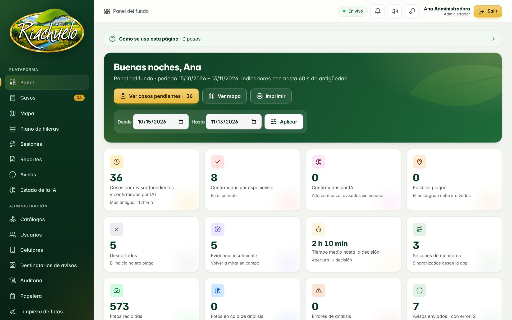

# Panel del fundo (vista completa con menú)



| Dato | Valor |
|---|---|
| Archivo | `03-manuales/media/web/p07-14.jpeg` |
| Documento | Manual de usuario · Plataforma web (v1.6.1) |
| Sección | La pantalla y la ayuda de cada página (línea 571 del manual) |
| Tipo | Captura de pantalla de la plataforma web |

## Qué muestra

Vista completa de la web con el menú lateral verde (logo, sección PLATAFORMA y sección ADMINISTRACIÓN), la barra superior con el estado «En vivo», notificaciones, sonido, contraseña, el usuario y «Salir», y el Panel del fundo con el saludo, el filtro de periodo y las tarjetas de indicadores.

## Texto visible

Menú: PLATAFORMA — Panel · Casos (36) · Mapa · Plano de hileras · Sesiones · Reportes · Avisos · Estado de la IA · ADMINISTRACIÓN — Catálogos · Usuarios · Celulares · Destinatarios de avisos · Auditoría · Papelera · Limpieza de fotos · Barra: Panel del fundo · ● En vivo · Ana Administradora (Administrador) · [Salir] · Cómo se usa esta página · 3 pasos · Buenas noches, Ana · Panel del fundo · periodo 15/10/2026 – 13/11/2026. Indicadores con hasta 60 s de antigüedad. · [Ver casos pendientes · 36] [Ver mapa] [Imprimir] · Desde 10/15/2026 · Hasta 11/13/2026 · [Aplicar] · Tarjetas: 36 Casos por revisar · 8 Confirmados por especialista · 0 Confirmados por IA · 0 Posibles plagas · 5 Descartados · 5 Evidencia insuficiente · 2 h 10 min Tiempo medio hasta la decisión · 3 Sesiones de monitoreo · 573 Fotos recibidas · 0 Fotos en cola de análisis · 0 Errores de análisis · 7 Avisos enviados · con error: 2

<details><summary>Texto reconocido automáticamente (OCR, sin corregir)</summary>

```text
PLATAFORMA
05 Panel
(MW Mapa
E Plano de hileras
S Sesiones
[Reportes
OD Avisos
(% Estado de la lA
ADMINISTRACIÓN
<LB Catálogos
Celulares
Destinatarios de avisos
Auditoría
Papelera
Limpieza de fotos
25 Panel del fundo
() Cómo se usa esta página - 3 pasos
Buenas noches, Ana
e Envio A
Panel del fundo - periodo 15/10/2026 — 13/11/2026. Indicadores con hasta 60 s de antiguedad.
Ver casos pendientes - 36 (WU Ver mapa
PERO 10/15/2026 O Sd 11/13/2026
Casos por revisar (pendientes
y confirmados por lA)
Más antiguo: 11 d 14 h
Descartados
El indicio no era plaga
573
Fotos recibidas
Confirmados por especialista
En el periodo
Evidencia insuficiente
Volver a mirar en campo
Fotos en cola de análisis
(2 Imprimir
Confirmados por lA
Alta confianza: avisados sin esperar
(el
2 h 10 min
Tiempo medio hasta la decisión
Apertura > decisión
Errores de análisis
19) Ana Administradora
Administrador
Posibles plagas
El encargado debe ir a verlas
Sesiones de monitoreo
Sincronizadas desde la app
(9)
Avisos enviados - con error: 2
[E Salir
```

</details>
