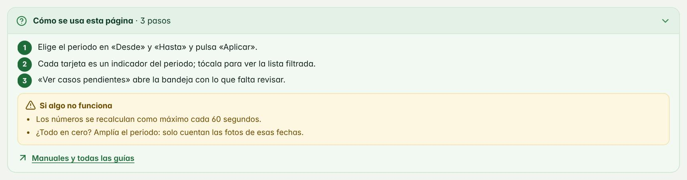

# Guía «Cómo se usa esta página» abierta (Panel)



| Dato | Valor |
|---|---|
| Archivo | `03-manuales/media/web/p08-16.jpeg` |
| Documento | Manual de usuario · Plataforma web (v1.6.1) |
| Sección | «Cómo se usa esta página» (línea 613 del manual) |
| Tipo | Captura de pantalla de la plataforma web |

## Qué muestra

La guía plegable del Panel desplegada: tres pasos numerados, un recuadro amarillo «Si algo no funciona» y el enlace a los manuales. Todas las pantallas de la web tienen una guía igual con sus propios pasos.

## Texto visible

Cómo se usa esta página · 3 pasos · 1 Elige el periodo en «Desde» y «Hasta» y pulsa «Aplicar». · 2 Cada tarjeta es un indicador del periodo; tócala para ver la lista filtrada. · 3 «Ver casos pendientes» abre la bandeja con lo que falta revisar. · Si algo no funciona: Los números se recalculan como máximo cada 60 segundos. · ¿Todo en cero? Amplía el periodo: solo cuentan las fotos de esas fechas. · ↗ Manuales y todas las guías

<details><summary>Texto reconocido automáticamente (OCR, sin corregir)</summary>

```text
() Cómo se usa esta página - 3 pasos
(1) Elige el periodo en «Desde» y «Hasta» y pulsa «Aplicar».
(6) Cada tarjeta es un indicador del periodo; tócala para ver la lista filtrada.
O «Ver casos pendientes» abre la bandeja con lo que falta revisar.
A Si algo no funciona
+ Los números se recalculan como máximo cada 60 segundos.
+ ¿Todo en cero? Amplía el periodo: solo cuentan las fotos de esas fechas.
2 Manuales y todas las guías
```

</details>
