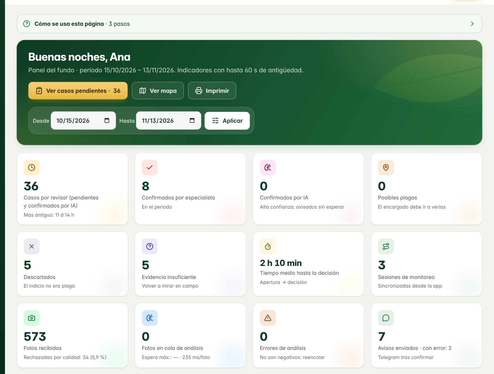

# Panel del fundo: indicadores



| Dato | Valor |
|---|---|
| Archivo | `03-manuales/media/web/p09-19.jpeg` |
| Documento | Manual de usuario · Plataforma web (v1.6.1) |
| Sección | Panel del fundo (línea 653 del manual) |
| Tipo | Captura de pantalla de la plataforma web |

## Qué muestra

Detalle del Panel: encabezado verde con saludo, accesos y filtro de periodo, y doce tarjetas de indicadores con una línea de contexto debajo de cada número (por ejemplo, el caso más antiguo, el porcentaje rechazado por calidad o los avisos con error).

## Texto visible

Buenas noches, Ana · periodo 15/10/2026 – 13/11/2026 · 36 Casos por revisar (pendientes y confirmados por IA) · Más antiguo: 11 d 14 h · 8 Confirmados por especialista · En el periodo · 0 Confirmados por IA · Alta confianza: avisados sin esperar · 0 Posibles plagas · El encargado debe ir a verlas · 5 Descartados · El indicio no era plaga · 5 Evidencia insuficiente · Volver a mirar en campo · 2 h 10 min Tiempo medio hasta la decisión · Apertura → decisión · 3 Sesiones de monitoreo · Sincronizadas desde la app · 573 Fotos recibidas · Rechazadas por calidad: 34 (5,9 %) · 0 Fotos en cola de análisis · Espera máx.: — · 235 ms/foto · 0 Errores de análisis · No son negativos: reencolar · 7 Avisos enviados · con error: 2 · Telegram tras confirmar

<details><summary>Texto reconocido automáticamente (OCR, sin corregir)</summary>

```text
() Cómo se usa esta página - 3 pasos
Buenas noches, Ana
Panel del fundo - periodo 15/10/2026 - 13/11/2026. Indicadores con hasta 60 s de antigiiedad.
Ver casos pendientes - 36 (WU Ver mapa
PESE 10/15/2026 O MESA 11/13/2026
(0)
Casos por revisar (pendientes
y confirmados por lA)
Más antiguo: 11 d 14 h
Descartados
El indicio no era plaga
573
Fotos recibidas
Rechazadas por calidad: 34 (5,9 %)
Confirmados por especialista
En el periodo
Evidencia insuficiente
Volver a mirar en campo
Fotos en cola de análisis
Espera máx.: —- 235 ms/foto
(2 Imprimir
Confirmados por lA
Alta confianza: avisados sin esperar
(0)
2 h 10 min
Tiempo medio hasta la decisión
Apertura > decisión
Errores de análisis
No son negativos: reencolar
Posibles plagas
El encargado debe ir a verlas
Sesiones de monitoreo
Sincronizadas desde la app
Avisos enviados - con error: 2
Telegram tras confirmar
```

</details>
