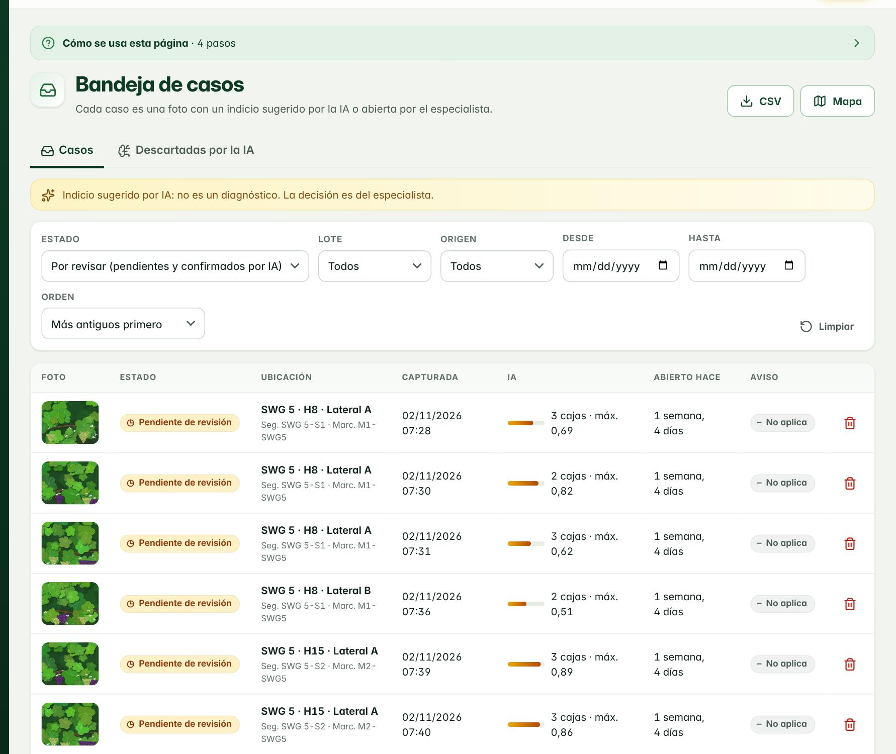

# Bandeja de casos



| Dato | Valor |
|---|---|
| Archivo | `03-manuales/media/web/p11-22.jpeg` |
| Documento | Manual de usuario · Plataforma web (v1.6.1) |
| Sección | Bandeja de casos (línea 755 del manual) |
| Tipo | Captura de pantalla de la plataforma web |

## Qué muestra

Bandeja del especialista con las pestañas «Casos» y «Descartadas por la IA», el aviso fijo de que la IA solo sugiere, los filtros (estado, lote, origen, fechas, orden) y la tabla de casos con miniatura, estado, ubicación, fecha de captura, cajas de la IA con su confianza máxima, antigüedad, aviso y botón de papelera.

## Texto visible

Cómo se usa esta página · 4 pasos · Bandeja de casos · Cada caso es una foto con un indicio sugerido por la IA o abierta por el especialista. · [CSV] [Mapa] · Casos | Descartadas por la IA · Indicio sugerido por IA: no es un diagnóstico. La decisión es del especialista. · ESTADO Por revisar (pendientes y confirmados por IA) · LOTE Todos · ORIGEN Todos · DESDE · HASTA · ORDEN Más antiguos primero · Limpiar · Columnas: FOTO · ESTADO · UBICACIÓN · CAPTURADA · IA · ABIERTO HACE · AVISO · Filas (ejemplo): Pendiente de revisión · SWG 5 · H8 · Lateral A · Seg. SWG 5-S1 · Marc. M1-SWG5 · 02/11/2026 07:28 · 3 cajas · máx. 0,69 · 1 semana, 4 días · No aplica (más filas de H8 y H15 con 2–3 cajas y máximos entre 0,51 y 0,89)

<details><summary>Texto reconocido automáticamente (OCR, sin corregir)</summary>

```text
() Cómo se usa esta página - 4 pasos
a Bandeja de casos
Cada caso es una foto con un indicio sugerido por la IA o abierta por el especialista.
(A Casos 8% Descartadas por la lA
SP Indicio sugerido por IA: no es un diagnóstico. La decisión es del especialista.
ESTADO LOTE ORIGEN
Por revisar (pendientes y confirmados por lA) v Todos v Todos
ORDEN
Más antiguos primero y
FOTO ESTADO UBICACIÓN CAPTURADA
SWG 5 - H8 : Lateral A
O Pendiente de revisión Seg. SWG 5-1 - Marc. M1- 02/11/2026
SwG5 07:28
SWG 5 - H8 - Lateral A
O Pendiente de revisión Seg. SWG 5-S1 - Marc. M1- PEN
SWG5 7
SWG 5 - H8 - Lateral A
O Pendiente de revisión Seg. SWG 5-1 - Marc. M1- 02/11/2026
SwG5 07:31
SWG 5 - H8 - Lateral B
O Pendiente de revisión Seg. SWG 5-1 - Marc. M1- 02/11/2026
Sw65 07:36
SWG 5 - H15 - Lateral A
O Pendiente de revisión Seg. SWG 5-S2 - Marc. M2- 02/11/2026
SwG5 07:39
SWG 5 - H15 - Lateral A
O Pendiente de revisión Seg. SWG 5-S2 - Marc. M2- DS IA0zS
SWG5
DESDE
vY mm/dd/yyyy
3 cajas -
0,69
2 cajas -
0,82
3 cajas -
0,62
2 cajas -
0,51
3 cajas -
0,89
3 cajas -
0,86
máx.
máx.
máx.
máx.
máx.
máx.
HASTA
(m] mm/dd/yyyy O
ABIERTO HACE
1 semana,
4 días
1 semana,
4 días
1 semana,
4 días
1 semana,
4 días
1 semana,
4 días
1 semana,
4 días
Y CSsv (WU Mapa
O Limpiar
AVISO
- No aplica 10]
- No aplica 10]
- No aplica 10]
- No aplica 0]
- No aplica 10]
- No aplica 0]
```

</details>
